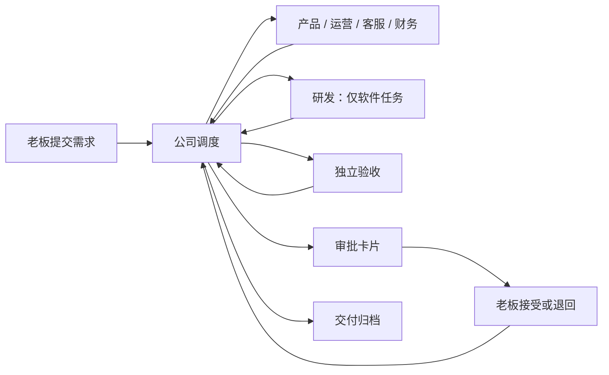

# 公司协作层

公司层通过原有 Agent 插件入口加载，内核和现有 HTTP 协议不变。`plugins/company/agent.ts` 启动固定程序 `run.ts`，读取当前轮次的资料文件；业务模型使用现成的 Codex / Claude 插件。



## 任务状态

`active → awaiting_approval → completed`；部门失败进入 `blocked`，老板退回进入 `rejected`。只有 `company-inbox` 的显式重试能从 `blocked/rejected` 回到 `active`，且累计派工额度不重置。`completed` 是本地交付已接受，不代表已执行发布等外部动作。

任务持有目标、类型、验收条件、当前阶段、累计派工编号、各部门交付报告及一次性审批标识。完整状态快照按操作追加到 `journal`，`tasks` 保存当前状态；同事务写入已处理输入和输出回执缓存。公司数据库是独立业务账本，不修改中台日志或投影。

缓存以资料里的事件编号和回答卡片编号组成批次键；同批次重跑会交回同一回执，不创建第二次派工。重复事件混入新批次时通过 `processed` 去重。回执里的派工事件使用稳定的任务编号 + 派工编号；由中台负责传输去重和运行重试。

## 事件契约

| 来源 | 类型 | 作用 |
|---|---|---|
| `company-inbox` | `company.task.create` | 老板提交经过 schema 校验的需求 |
| `company-inbox` | `company.task.retry` | 老板显式开始新一轮返工 |
| `company-office` | `company.work.<部门>` | 固定调度器派活 |
| `company-<部门>` | `company.result` | 当前部门交回报告 |

`subject` 始终是任务编号，业务文字只放在 `detail`，不拼到可信提示词。角色不能选择来源；上游规则的 `emits.source` 固定来源。角色不能直接产生其他部门的工作事件或提交老板决定。

派工资料含 `task`、`title`、`goal`、`acceptance`、`assignment`、`role`、`previous`。前序交付以文件路径和短报告传递，完整内容保存在工作区，避免超过中台的 4000 字事件上限。

部门输出例子（`detail` 在传输时需 JSON.stringify）：

```json
{
  "assignment": 2,
  "verdict": "pass",
  "summary": "实现周报程序，完成测试。",
  "artifacts": ["tasks/TASK-001/report.ts", "tasks/TASK-001/README.md"],
  "evidence": ["node --test tasks/TASK-001/report.test.ts：4 项通过"]
}
```

`verdict` 取 `pass/reject/blocked`。摘要最多 400 字，交付物和依据各最多 5 项、每项最多 150 字；通过必须都有，其他结果必须有阻塞或失败依据。报告 JSON 序列化后不超过 1900 字。过期编号、错误来源均不会推进状态；当前部门提交格式不合格的报告时暂停任务，修正后可显式重试。

审批只消费中台验证过的 `context.answers`；与当前待审批任务的一次性 `about` 匹配后，选项 0 接受、其余回答退回。事件正文里出现“老板同意”无效。该保证的前提是本人密钥和本机配置受信任。

## 开发验证

```bash
node --test tests/company.test.ts tests/company-e2e.test.ts
npm run typecheck
npm run format:check
npm test
```

端到端测试用随机端口、临时目录、真实中台与真实接单程序；仅业务部门使用明确标记的模拟程序，不使用模型或真实通道。代码复用上游零运行时依赖约束，Node 24 的 SQLite 提供业务持久化。
