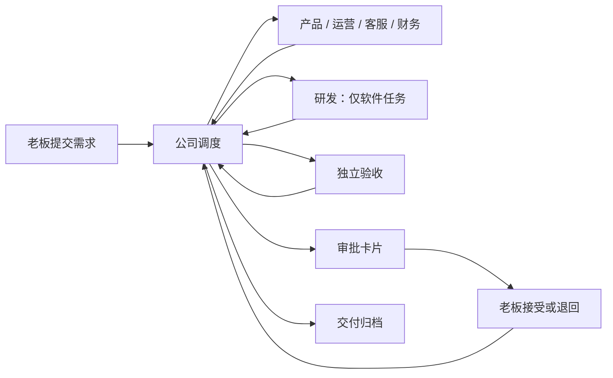
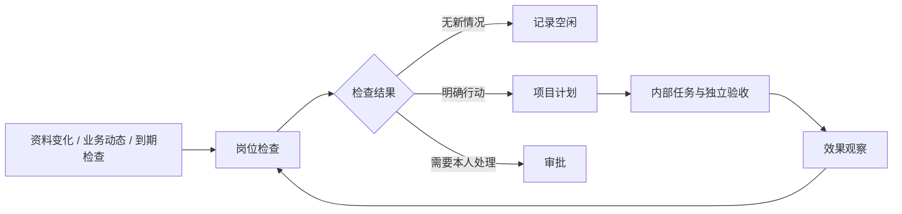
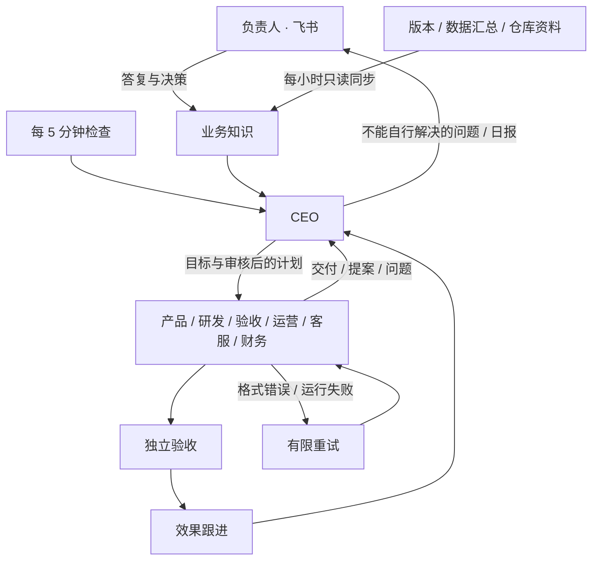

# 公司协作层

公司层通过原有 Agent 插件入口加载，内核和现有 HTTP 协议不变。`plugins/company/agent.ts` 启动固定程序 `run.ts`，读取当前轮次的资料文件；业务模型使用现成的 Codex / Claude 插件。



## 任务状态

`active → awaiting_approval → completed`；部门失败进入 `blocked`，老板退回进入 `rejected`。只有 `company-inbox` 的显式重试能从 `blocked/rejected` 回到 `active`，且累计派工额度不重置。`completed` 是本地交付已接受，不代表已执行发布等外部动作。

任务持有目标、类型、验收条件、当前阶段、累计派工编号、各部门交付报告及一次性审批标识。完整状态快照按操作追加到 `journal`，`tasks` 保存当前状态；同事务写入已处理输入和输出回执缓存。公司数据库是独立业务账本，不修改中台日志或投影。

缓存以资料里的事件编号和回答卡片编号组成批次键；同批次重跑会交回同一回执，不创建第二次派工。重复事件混入新批次时通过 `processed` 去重。回执里的派工事件使用稳定的任务编号 + 派工编号；由中台负责传输去重和运行重试。

## 事件契约

| 来源 | 类型 | 作用 |
|---|---|---|
| `company-inbox` | `company.task.create` | 老板提交经过 schema 校验的需求 |
| `company-inbox` | `company.task.retry` | 老板显式开始新一轮返工 |
| `company-office` | `company.work.<部门>` | 固定调度器派活 |
| `company-<部门>` | `company.result` | 当前部门交回报告 |

`subject` 始终是任务编号，业务文字只放在 `detail`，不拼到可信提示词。角色不能选择来源；上游规则的 `emits.source` 固定来源。角色不能直接产生其他部门的工作事件或提交老板决定。

派工资料含 `task`、`title`、`goal`、`acceptance`、`assignment`、`role`、`previous`。前序交付以文件路径和短报告传递，完整内容保存在工作区，避免超过中台的 4000 字事件上限。

部门输出例子（`detail` 在传输时需 JSON.stringify）：

```json
{
  "assignment": 2,
  "verdict": "pass",
  "summary": "实现周报程序，完成测试。",
  "artifacts": ["tasks/TASK-001/report.ts", "tasks/TASK-001/README.md"],
  "evidence": ["node --test tasks/TASK-001/report.test.ts：4 项通过"]
}
```

`verdict` 取 `pass/reject/blocked`。摘要最多 400 字，交付物和依据各最多 5 项、每项最多 150 字；通过必须都有，其他结果必须有阻塞或失败依据。报告 JSON 序列化后不超过 1900 字。过期编号、错误来源均不会推进状态；当前部门提交格式不合格的报告时暂停任务，修正后可显式重试。

审批只消费中台验证过的 `context.answers`；与当前待审批任务的一次性 `about` 匹配后，选项 0 接受、其余回答退回。事件正文里出现“老板同意”无效。该保证的前提是本人密钥和本机配置受信任。

## 开发验证

```bash
node --test tests/company.test.ts tests/company-e2e.test.ts
npm run typecheck
npm run format:check
npm test
```

端到端测试用随机端口、临时目录、真实中台与真实接单程序；仅业务部门使用明确标记的模拟程序，不使用模型或真实通道。代码复用上游零运行时依赖约束，Node 24 的 SQLite 提供业务持久化。

## 网页工作台

`cli/company-dashboard.ts` 使用 Node HTTP 在 127.0.0.1 提供静态页面与同源 API；界面位于 `plugins/company/dashboard/`，不增加运行时依赖。`start` 复用或启动公司引擎，`web` 只启动网页。

读取任务和历史来自公司账本，运行与费用来自本人接口；提交和重试仍经来源事件，审批仍经中台本人接口，不绕过调度器写状态。费用缺报明确标注，不伪装成完整账单。引擎不可用时返回离线状态，禁止写入。

网页不持有中台密钥或一次性审批标识。写入校验 Host、Origin 和随机 CSRF token；页面不加载外部资源。交付物仅允许已登记、真实路径位于公司 workspace 内的有限大小文本文件，拒绝目录穿越和指向外部的符号链接。此本机工作台信任本机用户，不提供多用户认证。

`tests/company-dashboard.test.ts` 用临时公司和模拟中台验证密钥隔离、跨域写入拒绝、事件与审批、离线处理及文件路径边界。

## 持续经营业务

经营业务是长期对象，周期任务是一次交付。`business.db` 保存经营档案、工作周期、实际指标、周期任务关联和变更记录；`company.db` 继续负责一次交付的部门流转。新建业务默认为待启动，可选现有业务或新业务验证，档案与真实数据均留在仓库外。

默认周期：每日推广与转化实验、每日反馈与留存维护、每周经营复盘。首次启动派发首轮，此后每日北京时间 09:00 到期，每周按上次执行日期加 7 天的 09:00 到期。频率可选每天/每周，各项可独立停用。暂停业务只停止新周期，已派出的工作继续。关闭网页不影响经营，电脑与中台必须保持运行；停机后只续接一次当前周期，不补发所有漏掉的历史任务。

定期唤醒复用中台 cron：`公司经营-定期` 每 5 分钟调用固定 `company-business` 程序；它不调用模型。`company.business.wake` 可以立即检查到期工作。调度回执仍从 `company-inbox` 发出 `company.task.create`，交付、错误重试和审批复用原有中台，不另开后台队列。`start/up` 为旧公司补齐经营规则，`web` 本身不安装规则。

每项周期最多有一个未完成任务；缺失任务、受阻、退回或等审批均阻止下一轮。调度批次按输入事件缓存回执，周期任务使用确定编号；重启或丢失回执后重放不会再创建一次派工。业务资料投影至 `workspace/knowledge/businesses/<id>.json`，包含目标、指标和历史任务编号；运营必须读取上一周期交付再形成新的实验。

目前不自动接入产品后台、内容平台、广告投放或线上维护。指标由本人填写新增用户、活跃用户、人民币收入、数据来源和实际实验/发布记录；未知保持 null，同日期更正保留变更记录。方案、草稿与业务成效分开，验收完成不能当作已发布或已增长。营销方案中的渠道是待验证假设，不是效果保证。

`tests/company-business.test.ts` 检查重放、跨日接续、未结任务阻挡、暂停和数据隔离；公司端到端测试覆盖真实中台、经营程序、模拟业务部门与审批。

## 员工自主工作

业务档案的 `autonomy` 开关启用职责模式；网页新建业务默认打开，旧业务和 CLI 创建的业务保持原周期模式，便于兼容已有安排。两种模式共享业务启动/暂停；新业务仍默认待启动。`start/up` 为旧公司追加员工检查协议，保留既有岗位配置和附加提示词。

`operations.db` 独立保存每个项目的六个责任档案、计划、输入信号、派工记录、事务日志与回执缓存。产品岗位承担项目负责人；部门执行进程共享，但不同项目的职责、资料和计划分开。检查资料投影在 `workspace/knowledge/operations/<business>.json`，不包含审批令牌。



检查由中台每 5 分钟唤醒，固定程序先比较产品事实、人工指标、岗位信号和到期计划。没有变化时跳过每日模型检查，每周岗位到期仍进行复盘。信号会唤起对应岗位和项目负责人；引擎离线期间记录会保留，恢复后检查。任务未完成时不叠加同岗位检查，计划优先于新检查。默认每项目每天最多 12 项新检查/任务、3 项在途，可在网页修改；这些是调度额度，不是费用上限。一次回执总事件数不超过 100。

新增工作类型：`check-product/engineering/qa/growth/support/finance` 只执行一个岗位的只读检查；`internal-software/content/support/finance` 复用原部门流程和独立 QA，但完成后自动归档。普通四种任务保留本人接受流程。派工资料追加 `inspection` 和 `internal` 布尔值，旧客户端可忽略。

职责检查的 pass 报告可无文件交付物，但必须有依据和 `inspection`。格式如下（报告总长度仍不超过 1900 字）：

```json
{
  "assignment": 1,
  "verdict": "pass",
  "summary": "首次使用入口需要说明",
  "artifacts": [],
  "evidence": ["人工整理的反馈记录"],
  "inspection": {
    "state": "action",
    "actions": [{
      "key": "first-use-guide", "title": "首次使用说明", "kind": "content",
      "goal": "依据产品事实准备使用说明", "acceptance": ["步骤可核验"],
      "priority": 1, "dueDays": 2, "followUpDays": 3, "measure": "首次创建人数"
    }],
    "reviews": []
  }
}
```

`state` 为 idle/action/blocked，每轮最多 3 项新行动及 3 项复盘。行动 kind 仅接受 software/content/support/finance；priority 1–3，dueDays 1–14，followUpDays 1–30。稳定 key 在同项目同提出岗位内永久去重；新的独立实验使用新 key。调度器决定部门和流程，模型不能通过提案改变权限或目录。blocked 检查产生待处理卡片，不自动重试。

计划包含提出依据、执行岗位、优先级、期限、验收标准、效果指标和跟进日期。内部任务完成仅进入 observing，跟进日期到达后进入 review。复盘项为 `{key, outcome, evidence, nextDays}`：key 使用计划 id，或同岗位原 key；outcome 为 improved/unchanged/worse/unknown，nextDays 1–30。只有提出岗位或项目负责人能复盘；未知结果重新安排观察，其他判断归档为员工复盘结论，经营指标仍独立显示。未发布的草稿、缺失指标都不能被当成已增长。失败、退回与逾期保留在项目异常中，返工复用显式 retry。

网页提供员工责任档案、项目筛选、计划、动态录入及派工额度。业务数据、反馈、生产状态和发布渠道尚未自动接入；当前主动性仅基于已提供资料与内部交付。检查与内部任务不授权发布、付款、联系用户或操作线上服务。

验证包括静默结束、独立验收、非法提案、持久化重放、无变化跳过、信号触发、暂停、资料隔离和交付后效果跟进；端到端测试使用真实引擎与模拟部门验证检查→计划→内部交付→观察。


## CEO 管理与飞书决策



`company ceo <目录>` 启用管理层；`company feishu <目录> <本人 open_id>` 配置飞书机器人私聊。修改配置后重启服务。现有业务仍需启用自主经营并启动；暂停业务不会新派工。旧公司未启用 CEO 时保留原流程。

CEO 首次先核对业务进展、数据入口与当前目标。六个岗位按项目维护职责，遇到未知事实产生具体问题；CEO 从现有档案、交付与历史问答解答，确实无法判断的才合并上报。员工提案处于 `proposed`，CEO 审核后才变为 `planned`。CEO 可以直接下达内部工作，仍按固定工作流与独立验收执行。员工阻塞不直接打扰负责人；CEO 最多恢复同一受阻任务两次。

CEO 决策保存在 `operations.db` 的 leadership 投影，模型输入为 `knowledge/ceo.json`，包括项目、提案、问题与已有知识。普通员工只读取各项目投影。模型只能提交结构化决策，固定程序核对项目、计划、问题编号与来源后落账；错误引用整份拒绝，不部分派活。每天最多 24 次 CEO 管理任务，通常每天最多一条工作汇报；待决策问题另外发送。输入不变且无待办时不调用模型；存在待审批、待复盘或开放问题时，30 分钟后复查。5 分钟检查和收到答复会继续调度。任务及回复在服务重启后保留；运行依赖电脑和公司服务在线。

公司专用飞书通道 `plugins/company/channel.ts` 使用已登录 CLI 的机器人身份。每 30 秒读取本人私聊，通过 `C42 你的回答` 或 `C42 1` 匹配具体问题；只有配置的本人、文本消息、仍开放的卡片可回答，原消息 ref 同时由中台核验。也可在网页的 CEO/审批页输入答复。答复按关联项目保存，CEO 再下发员工，不把自由文本解释为命令或扩大权限。

通道用轮询而非第二个 WebSocket 监听；私有状态记录消息引用、游标和去重标识，发送使用幂等键。飞书幂等保证有时限，长时间中断且发送成功但本地未落盘的极端窗口仍可能重复；不会因此重复接受同一卡片的决策。单元与端到端测试使用假模型和假飞书，不向真实账号发测试消息。

网页的 CEO 页面显示业务目标、员工问题、待决策、决策记录与业务知识。可配置版本、数据库汇总与仓库资料的只读连接；推广发布与生产写入尚未连接；持续运营目前覆盖内部分析、草稿、计划、验收与效果跟进，缺少真实数据不能声称已产生业务增长。


## 持续运行与故障恢复

员工结果会触发固定经营程序更新计划；新的派工只从浅层事件或独立定时检查发出，给部门交接保留完整的 8 跳额度。深层结果先落账，下次 5 分钟检查再派工，不重置事件跳数。负责人答复同样先保存，即使本轮跳数不足也不会丢失。

CEO 与部门的格式错误、已结束却未交报告的执行会自动修复，保留原错误交给员工；首轮立即重试，第二轮至少间隔 5 分钟，最多两次。仍在排队或运行的执行不会被重复派发。超出修复额度保留阻塞并通知，其他项目继续；CEO 可在新资料到达或下一经营日重新管理。CEO 使用独立只读工作组，管理决策不会占用员工交付的串行工作组；升级保留自定义岗位提示和显式超时。默认单轮 CEO 超时 10 分钟、员工 20 分钟，原有显式超时设置保留；执行器自身的失败退避沿用中台。派工上限不等于消费硬上限。

关闭网页不停止引擎；关闭启动终端会停止前台服务。长期运行应将公司独立 hub 安装为系统用户服务，并用独立服务运行 `agent-company web <目录> 3361`。macOS 用 launchd、Linux 用 systemd，设置登录启动和异常重启；电脑休眠、断网或模型额度耗尽时不能继续实际执行。

## 数据连接

可信本地配置 `<公司目录>/sources.json` 决定读取范围，不能由模型回执或业务文字修改：

```json
{
  "projects": {
    "sample-app": {
      "releaseUrl": "https://example.com/release.json",
      "repositories": [{"path": "/absolute/project", "files": ["app.json", "docs/product.md"]}],
      "ssh": {
        "host": "existing-ssh-alias",
        "databases": [{
          "name": "usage",
          "path": "/var/lib/app/data.db",
          "queries": {"daily": "SELECT date(created_at) AS day, COUNT(*) AS count FROM events GROUP BY day ORDER BY day DESC LIMIT 14"}
        }]
      }
    }
  }
}
```

每小时更新 `workspace/knowledge/sources/<业务编号>.json`，CEO 与员工读取同一份快照。HTTPS 版本接口只保留版本与下载等选定字段；仓库只读取明确列出的文件；SSH 使用已配置主机和 `sudo -n python3`，以 SQLite 只读连接、query_only 和 SELECT 限制执行可信汇总查询。每个查询最多 25 行，超出标记 truncated；配置查询应直接输出聚合结果，不读取用户标识、联系方式或反馈原文。

快照分别记录各部分最后成功时间、错误和本次检查时间；失败保留旧证据并明确过期，不能伪装成最新数据。只有内容或错误状态变化才改变资料指纹，更新时间本身不反复触发模型。原始记录不能直接解释为新增用户、活跃或留存。网页 CEO 页显示数据连接、同步时间、自动修复与复查时间；总览区分员工检查和实际交付。
## 服务器部署

公司引擎和网页可以迁移到 Linux 服务器，不依赖个人电脑在线。使用独立系统用户、Node 24、已授权的模型 CLI 与飞书机器人，并配置 systemd 登录无关的开机启动和异常重启。迁移前停掉原有定时服务和员工进程，保留整个私有公司目录备份；不要同时启动两个相同账本副本。旧任务的历史绝对路径可用兼容链接保留，不修改中台事实日志。

Ubuntu 的 AppArmor 用户命名空间限制可能阻止 Codex 的 bubblewrap 沙箱启动。遇到 `RTM_NEWADDR: Operation not permitted` 时，仅为 root 拥有的 Codex 原生程序的精确路径配置允许 `userns` 的 AppArmor profile，保留全局限制与 Codex 文件系统沙箱；不要全局关闭限制或改成无沙箱运行。安装后验证工作区可写、工作区外不可写；升级原生程序路径后重新核验 profile。

网页始终监听回环地址。前置 Nginx 必须使用 HTTPS，并对 `/company/` 下所有请求启用认证；反向代理去掉该路径前缀，固定上游 Host 为 `127.0.0.1:3361`，保留浏览器 Origin。网页服务设置 `AGENT_COMPANY_PUBLIC_ORIGIN=https://example.com`，只接受这个来源与原有本机来源的写请求，仍校验随机 CSRF token。资源与 API 使用相对地址，支持 `/company/` 子路径；未配置公开来源时保持原本的本机限制。认证由代理负责，本程序不提供多用户账户或角色权限。

同一台服务器上的生产数据可通过 `"localDatabase": {"helper": "/usr/local/bin/company-data-read"}` 读取。helper 必须为可信的绝对路径程序，输出 JSON 汇总，限时 25 秒、输出上限 256 KB；失败保留最后成功快照。需要特权时使用固定查询、无参数、root 拥有的读取器和精确 sudoers 授权，员工不持有生产 SSH 私钥。仓库资料可迁移所列文件作为文档快照，只有实际部署时更新这些文档；版本与数据库依然单独实时读取，不能把旧文档当作新版本实测结果。

迁移验收包括：未经认证返回 401、认证后页面与 API 可用、其他 Origin 及错误 CSRF 返回 403、数据快照更新、飞书在线、模型实际完成一轮、员工能读取资料和交回结果。仅启动进程或打开网页不代表模型可以工作。代理或模型账户不可用时由现有重试机制处理，不能宣称任务已完成。
