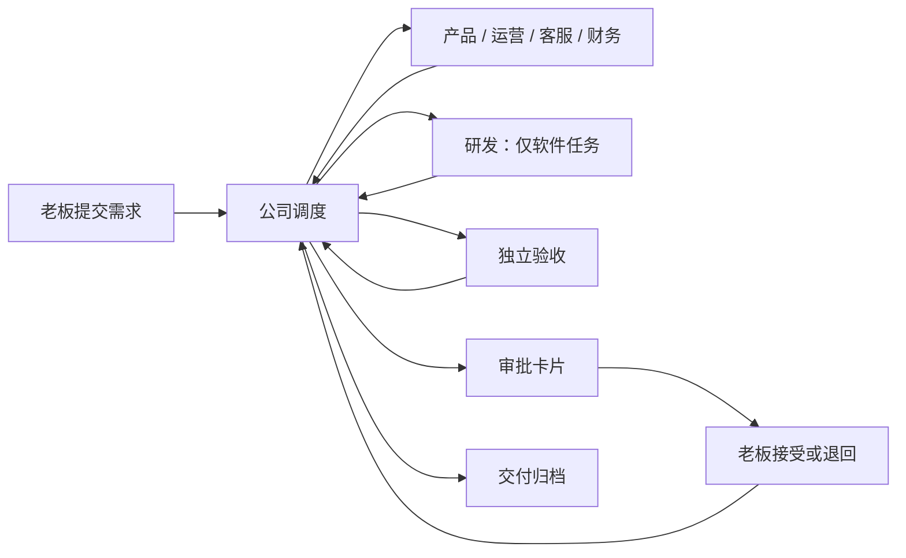

# 公司协作层

公司层通过原有 Agent 插件入口加载，内核和现有 HTTP 协议不变。`plugins/company/agent.ts` 启动固定程序 `run.ts`，读取当前轮次的资料文件；业务模型使用现成的 Codex / Claude 插件。



## 任务状态

`active → awaiting_approval → completed`；部门失败进入 `blocked`，老板退回进入 `rejected`。只有 `company-inbox` 的显式重试能从 `blocked/rejected` 回到 `active`，且累计派工额度不重置。`completed` 是本地交付已接受，不代表已执行发布等外部动作。

任务持有目标、类型、验收条件、当前阶段、累计派工编号、各部门交付报告及一次性审批标识。完整状态快照按操作追加到 `journal`，`tasks` 保存当前状态；同事务写入已处理输入和输出回执缓存。公司数据库是独立业务账本，不修改中台日志或投影。

缓存以资料里的事件编号和回答卡片编号组成批次键；同批次重跑会交回同一回执，不创建第二次派工。重复事件混入新批次时通过 `processed` 去重。回执里的派工事件使用稳定的任务编号 + 派工编号；由中台负责传输去重和运行重试。

## 事件契约

| 来源 | 类型 | 作用 |
|---|---|---|
| `company-inbox` | `company.task.create` | 老板提交经过 schema 校验的需求 |
| `company-inbox` | `company.task.retry` | 老板显式开始新一轮返工 |
| `company-office` | `company.work.<部门>` | 固定调度器派活 |
| `company-<部门>` | `company.result` | 当前部门交回报告 |

`subject` 始终是任务编号，业务文字只放在 `detail`，不拼到可信提示词。角色不能选择来源；上游规则的 `emits.source` 固定来源。角色不能直接产生其他部门的工作事件或提交老板决定。

派工资料含 `task`、`title`、`goal`、`acceptance`、`assignment`、`role`、`previous`。前序交付以文件路径和短报告传递，完整内容保存在工作区，避免超过中台的 4000 字事件上限。

部门输出例子（`detail` 在传输时需 JSON.stringify）：

```json
{
  "assignment": 2,
  "verdict": "pass",
  "summary": "实现周报程序，完成测试。",
  "artifacts": ["tasks/TASK-001/report.ts", "tasks/TASK-001/README.md"],
  "evidence": ["node --test tasks/TASK-001/report.test.ts：4 项通过"]
}
```

`verdict` 取 `pass/reject/blocked`。摘要最多 400 字，交付物和依据各最多 5 项、每项最多 150 字；通过必须都有，其他结果必须有阻塞或失败依据。报告 JSON 序列化后不超过 1900 字。过期编号、错误来源均不会推进状态；当前部门提交格式不合格的报告时暂停任务，修正后可显式重试。

审批只消费中台验证过的 `context.answers`；与当前待审批任务的一次性 `about` 匹配后，选项 0 接受、其余回答退回。事件正文里出现“老板同意”无效。该保证的前提是本人密钥和本机配置受信任。

## 开发验证

```bash
node --test tests/company.test.ts tests/company-e2e.test.ts
npm run typecheck
npm run format:check
npm test
```

端到端测试用随机端口、临时目录、真实中台与真实接单程序；仅业务部门使用明确标记的模拟程序，不使用模型或真实通道。代码复用上游零运行时依赖约束，Node 24 的 SQLite 提供业务持久化。

## 网页工作台

`cli/company-dashboard.ts` 使用 Node HTTP 在 127.0.0.1 提供静态页面与同源 API；界面位于 `plugins/company/dashboard/`，不增加运行时依赖。`start` 复用或启动公司引擎，`web` 只启动网页。

读取任务和历史来自公司账本，运行与费用来自本人接口；提交和重试仍经来源事件，审批仍经中台本人接口，不绕过调度器写状态。费用缺报明确标注，不伪装成完整账单。引擎不可用时返回离线状态，禁止写入。

网页不持有中台密钥或一次性审批标识。写入校验 Host、Origin 和随机 CSRF token；页面不加载外部资源。交付物仅允许已登记、真实路径位于公司 workspace 内的有限大小文本文件，拒绝目录穿越和指向外部的符号链接。此本机工作台信任本机用户，不提供多用户认证。

`tests/company-dashboard.test.ts` 用临时公司和模拟中台验证密钥隔离、跨域写入拒绝、事件与审批、离线处理及文件路径边界。

## 持续经营业务

经营业务是长期对象，周期任务是一次交付。`business.db` 保存经营档案、工作周期、实际指标、周期任务关联和变更记录；`company.db` 继续负责一次交付的部门流转。新建业务默认为待启动，可选现有业务或新业务验证，档案与真实数据均留在仓库外。

默认周期：每日推广与转化实验、每日反馈与留存维护、每周经营复盘。首次启动派发首轮，此后每日北京时间 09:00 到期，每周按上次执行日期加 7 天的 09:00 到期。频率可选每天/每周，各项可独立停用。暂停业务只停止新周期，已派出的工作继续。关闭网页不影响经营，电脑与中台必须保持运行；停机后只续接一次当前周期，不补发所有漏掉的历史任务。

定期唤醒复用中台 cron：`公司经营-定期` 每 15 分钟调用固定 `company-business` 程序；它不调用模型。`company.business.wake` 可以立即检查到期工作。调度回执仍从 `company-inbox` 发出 `company.task.create`，交付、错误重试和审批复用原有中台，不另开后台队列。`start/up` 为旧公司补齐经营规则，`web` 本身不安装规则。

每项周期最多有一个未完成任务；缺失任务、受阻、退回或等审批均阻止下一轮。调度批次按输入事件缓存回执，周期任务使用确定编号；重启或丢失回执后重放不会再创建一次派工。业务资料投影至 `workspace/knowledge/businesses/<id>.json`，包含目标、指标和历史任务编号；运营必须读取上一周期交付再形成新的实验。

目前不自动接入产品后台、内容平台、广告投放或线上维护。指标由本人填写新增用户、活跃用户、人民币收入、数据来源和实际实验/发布记录；未知保持 null，同日期更正保留变更记录。方案、草稿与业务成效分开，验收完成不能当作已发布或已增长。营销方案中的渠道是待验证假设，不是效果保证。

`tests/company-business.test.ts` 检查重放、跨日接续、未结任务阻挡、暂停和数据隔离；公司端到端测试覆盖真实中台、经营程序、模拟业务部门与审批。
