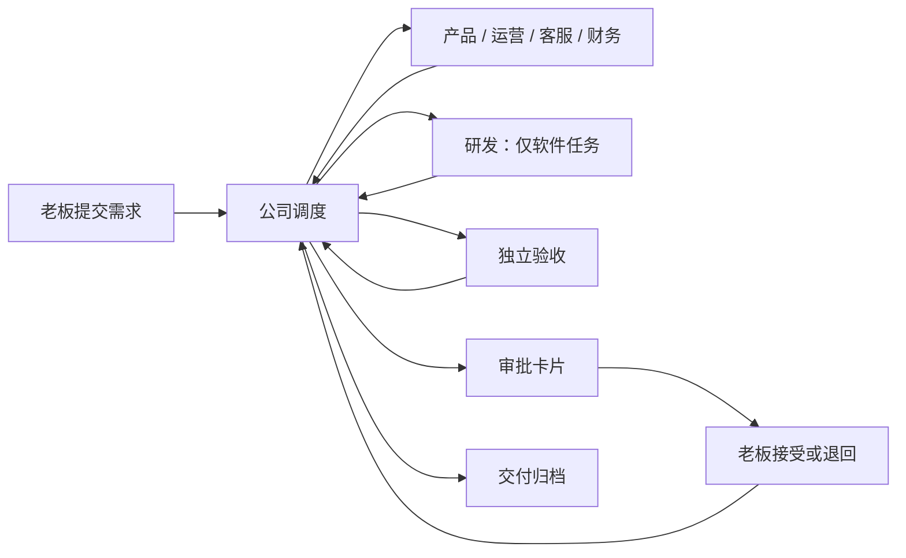
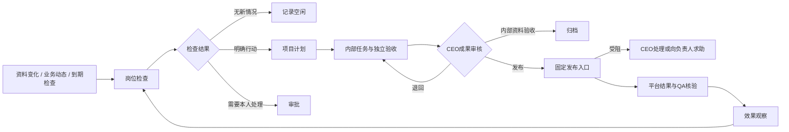
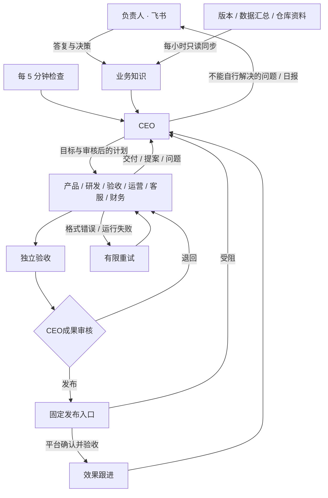

# 公司协作层

董事长日常流程见[公司流程](workflow.md)，本次断点与修复依据见[流程审计记录](workflow-audit.md)。

董事长确认的定位、在岗安排与分批改造计划见 [Agent Company 改造总方案](roadmap.md)。

公司层通过原有 Agent 插件入口加载，内核和现有 HTTP 协议不变。`plugins/company/agent.ts` 启动固定程序 `run.ts`，读取当前轮次的资料文件；业务模型使用现成的 Codex / Claude 插件。



## 任务状态

### 员工目标与每日安排

私有 `company.json` 的 `dailyPlanning: true` 配合 CEO 模式启用每日安排。CEO 决策可提交 `staffPlans`（每轮最多 6 位员工）：项目、岗位、当天日期、长期目标 `goal`、今日工作 `focus`、完成标准 `doneWhen`、模式 `work/followup/standby`、关联计划 `plan`、带时区的复查时间 `reviewAt`。执行安排必须关联该员工主责的已有计划 ID 或本轮新指令 key，不凭一段安排文字冒充派工；已关闭的计划只可关联跟进，不能重做。日期、员工、计划和时间全部通过校验后才整批保存。

每日北京时间 09:00 的管理日切换会唤醒 CEO；未完成的工作沿用，缺少今日安排的员工由 CEO 补齐，暂停业务不派工。今日指定计划优先于积压计划，已开工任务不被重复派发。跟进/待命到约定时间才创建一次检查；旧检查结果不能覆盖后来调整的安排。完成、受阻和到期会重新进入 CEO 管理，继续新任务或登记下一次具体跟进，不把文档完成当成业务结果。跨日仍执行尚未完成的到期跟进，不能只改日期而丢失检查。跟进安排切换到新执行任务时，未完成跟进保存在独立队列，保留原时间并在员工空闲时执行；员工页可展开查看。等待负责人发布时，CEO评估运营能继续推进的独立交付；已有素材足够或确无必要工作才待命，不强制六个岗位每天制造交付。

员工页显示岗位目标、计划日期、今日工作、完成标准和复查时间；项目知识与 CEO 全局资料使用相同持久记录。飞书安排只展示重点工作，完整目标和标准折叠。

小团队的推广草稿可在私有 `company.json` 设置 `ceoMode: true`、`contentReview: "ceo"`：运营包办标题、正文、封面和配图，自查后直接交 CEO 审核；CEO 不通过退回运营，不另派设计、产品协调或 QA。`internal-content` 的运营交付完成后进入原计划 `delivered`，仍须 CEO 审核，不自动发布或开始效果观察；软件等其他类型仍保留原验收。升级前已派出的 QA 结果兼容接收，不重复交付。

执行 `up` 更新岗位规范。未启用发布护栏时，小红书沿用 CEO 审核后交负责人本人发布的分工；真实平台草稿保存未接通时只能交付待导入文件，不得声称已入平台草稿箱。此设置不授予公开发布权限。

`active → awaiting_approval → completed`；部门失败进入 `blocked`，老板退回进入 `rejected`。只有 `company-inbox` 的显式重试能从 `blocked/rejected` 回到 `active`，且累计派工额度不重置。`completed` 是本地交付已接受，不代表已执行发布等外部动作。

任务持有目标、类型、验收条件、当前阶段、累计派工编号、各部门交付报告及一次性审批标识。完整状态快照按操作追加到 `journal`，`tasks` 保存当前状态；同事务写入已处理输入和输出回执缓存。公司数据库是独立业务账本，不修改中台日志或投影。

缓存以资料里的事件编号和回答卡片编号组成批次键；同批次重跑会交回同一回执，不创建第二次派工。重复事件混入新批次时通过 `processed` 去重。回执里的派工事件使用稳定的任务编号 + 派工编号；由中台负责传输去重和运行重试。

## 事件契约

| 来源 | 类型 | 作用 |
|---|---|---|
| `company-inbox` | `company.owner.question` | 飞书本人对话资料，交给 CEO 判断和处理 |
| `company-ceo` | `company.ceo.decision` | 对话中的内部决定，复用管理校验与派工 |
| `company-inbox` | `company.task.create` | 老板提交经过 schema 校验的需求 |
| `company-inbox` | `company.task.retry` | 老板显式开始新一轮返工 |
| `company-office` | `company.work.<部门>` | 固定调度器派活 |
| `company-<部门>` | `company.result` | 当前部门交回报告 |

任务事件的 `subject` 是任务编号，CEO 对话为 `owner`；业务文字只放在 `detail`，不拼到可信提示词。角色不能选择来源；上游规则的 `emits.source` 固定来源。角色不能直接产生其他部门的工作事件或提交老板决定。

派工资料含 `task`、`title`、`goal`、`acceptance`、`assignment`、`role`、`previous`。前序交付以文件路径和短报告传递，完整内容保存在工作区，避免超过中台的 4000 字事件上限。

部门输出例子（`detail` 在传输时需 JSON.stringify）：

```json
{
  "assignment": 2,
  "verdict": "pass",
  "summary": "实现周报程序，完成测试。",
  "artifacts": ["tasks/TASK-001/report.ts", "tasks/TASK-001/README.md"],
  "evidence": ["node --test tasks/TASK-001/report.test.ts：4 项通过"]
}
```

`verdict` 取 `pass/reject/blocked`。摘要最多 400 字，交付物和依据各最多 5 项、每项最多 150 字；通过必须都有，其他结果必须有阻塞或失败依据。报告 JSON 序列化后不超过 1900 字。过期编号、错误来源均不会推进状态；当前部门提交格式不合格的报告时暂停任务，修正后可显式重试。

审批只消费中台验证过的 `context.answers`；与当前待审批任务的一次性 `about` 匹配后，选项 0 接受、其余回答退回。事件正文里出现“老板同意”无效。该保证的前提是本人密钥和本机配置受信任。

## 开发验证

```bash
node --test tests/company.test.ts tests/company-e2e.test.ts
npm run typecheck
npm run format:check
npm test
```

端到端测试用随机端口、临时目录、真实中台与真实接单程序；仅业务部门使用明确标记的模拟程序，不使用模型或真实通道。代码复用上游零运行时依赖约束，Node 24 的 SQLite 提供业务持久化。

## 网页工作台

`cli/company-dashboard.ts` 使用 Node HTTP 在 127.0.0.1 提供静态页面与同源 API；界面位于 `plugins/company/dashboard/`，不增加运行时依赖。`start` 复用或启动公司引擎，`web` 只启动网页。

读取任务和历史来自公司账本，运行与费用来自本人接口；提交和重试仍经来源事件，审批仍经中台本人接口，不绕过调度器写状态。费用缺报明确标注，不伪装成完整账单。引擎不可用时返回离线状态，禁止写入。

网页不持有中台密钥或一次性审批标识。写入校验 Host、Origin 和随机 CSRF token；页面不加载外部资源。交付物仅允许已登记、真实路径位于公司 workspace 内的有限大小文本文件，拒绝目录穿越和指向外部的符号链接。此本机工作台信任本机用户，不提供多用户认证。

`tests/company-dashboard.test.ts` 用临时公司和模拟中台验证密钥隔离、跨域写入拒绝、事件与审批、离线处理及文件路径边界。

### 网页按需读取

工作台 `/api/*` 是公司客户端内部接口，不是内核协议。网页与服务端须一起更新：`overview` 不再提供完整任务、经营快照或 CEO 历史，旧网页需重新载入。

| 视图 | 数据及用途 |
|---|---|
| 首页 | `/api/overview` 的 `home`（额度、推广数据、备稿、运营当日状态和日报、CEO 最近结果及日报）、`businesses` 名称、完整待审批 `cards` |
| 导航、公司概览、部门 | `taskStats` 全量计数和各部门在途数、6 条任务摘要、`agents` 的 id/use/online、正在执行的 run 摘要、`spending`；不靠分页列表算全公司计数 |
| 等你处理、审批 | `cards` 保留 id/kind/title/text/options；确认、退回和文字回复仍走原答案接口；全文和配图仍按点击读取 `/api/publications/<key>` 及 `/image/<n>` |
| 任务列表、任务弹窗 | `/api/tasks` 仅提供 id/title/kind/status/stage；点击读取 `/api/tasks/<id>` 的完整任务与历史，交付物仍单独读取 |
| CEO 管理 | `/api/leadership` 的管理状态、最近任务状态、业务目标、数据连接、通道状态，以及最近决策、员工问题、业务知识；审批复用 overview |
| 员工、工作计划、业务设置 | `/api/operations` 的经营快照与关联任务摘要；当前任务只含摘要和受阻原因，交付全文点击读取 |
| 费用、执行记录 | `/api/runs` 的执行摘要及全量费用；费用不随分页改变 |

任务和执行记录默认最近 50 条，CEO 的三个历史集合分别默认最近 20 条；列表底部“加载更早”，任务搜索与筛选作用于已加载的摘要。`limit` 为 1–50 的整数，`before` 为服务器返回的游标：任务使用创建日志序号，执行使用轮次编号，CEO 使用三个历史集合的追加位置，新增记录不使旧页漂移。错误、重复或未知分页参数返回 400。单任务编号沿用 1–40 位字母数字、连字符及下划线约束，首位必须字母数字。

以上读取接口带内容 SHA-256 ETag，`If-None-Match` 匹配返回无正文的 304；不把当前请求时间放进 JSON 使缓存失效。浏览器记录成功同步时间。首页和审批页可见时每 30 秒更新；隐藏时暂停，恢复可见立即更新；详细视图只在进入和手动刷新时请求，再次进入先显示内存缓存。发生新内容时恢复为最近一页；未变时保留已加载的旧页。

只把 overview 存入 localStorage，读取或写入失败不影响使用；打开先显示带“更新中”的缓存，联网确认前禁用审批。ETag 和缓存不改变原有 Host、来源、CSRF 校验及前置 HTTPS 认证。每次 overview 请求的任务、经营档案与 CEO 数据各读取解析一次，经营投影复用该份 CEO 数据；不触发模型、事件或发布。

## 持续经营业务

经营业务是长期对象，周期任务是一次交付。`business.db` 保存经营档案、工作周期、实际指标、周期任务关联和变更记录；`company.db` 继续负责一次交付的部门流转。新建业务默认为待启动，可选现有业务或新业务验证，档案与真实数据均留在仓库外。

默认周期：每日推广与转化实验、每日反馈与留存维护、每周经营复盘。首次启动派发首轮，此后每日北京时间 09:00 到期，每周按上次执行日期加 7 天的 09:00 到期。频率可选每天/每周，各项可独立停用。暂停业务只停止新周期，已派出的工作继续。关闭网页不影响经营，电脑与中台必须保持运行；停机后只续接一次当前周期，不补发所有漏掉的历史任务。

定期唤醒复用中台 cron：`公司经营-定期` 每 5 分钟调用固定 `company-business` 程序；它不调用模型。`company.business.wake` 可以立即检查到期工作。调度回执仍从 `company-inbox` 发出 `company.task.create`，交付、错误重试和审批复用原有中台，不另开后台队列。`start/up` 为旧公司补齐经营规则，`web` 本身不安装规则。

每项周期最多有一个未完成任务；缺失任务、受阻、退回或等审批均阻止下一轮。调度批次按输入事件缓存回执，周期任务使用确定编号；重启或丢失回执后重放不会再创建一次派工。业务资料投影至 `workspace/knowledge/businesses/<id>.json`，包含目标、指标和历史任务编号；运营必须读取上一周期交付再形成新的实验。

内容平台需配置专用发布入口；不会自动发现账号或启用广告投放、线上维护。指标由本人填写新增用户、活跃用户、人民币收入、数据来源和实际实验/发布记录；未知保持 null，同日期更正保留变更记录。方案、草稿与业务成效分开，验收完成不能当作已发布或已增长。营销方案中的渠道是待验证假设，不是效果保证。

`tests/company-business.test.ts` 检查重放、跨日接续、未结任务阻挡、暂停和数据隔离；公司端到端测试覆盖真实中台、经营程序、模拟业务部门与审批。

## 员工自主工作

业务档案的 `autonomy` 开关启用职责模式；网页新建业务默认打开，旧业务和 CLI 创建的业务保持原周期模式，便于兼容已有安排。两种模式共享业务启动/暂停；新业务仍默认待启动。`start/up` 为旧公司追加员工检查协议，保留既有岗位配置和附加提示词。

`operations.db` 独立保存每个项目的六个责任档案、计划、输入信号、派工记录、事务日志与回执缓存。产品岗位承担项目负责人；部门执行进程共享，但不同项目的职责、资料和计划分开。检查资料投影在 `workspace/knowledge/operations/<business>.json`，不包含审批令牌。



检查由中台每 5 分钟唤醒，固定程序先比较产品事实、人工指标、岗位信号和到期计划。没有变化时跳过每日模型检查，每周岗位到期仍进行复盘。信号会唤起对应岗位和项目负责人；引擎离线期间记录会保留，恢复后检查。任务未完成时不叠加同岗位检查，计划优先于新检查。每项目默认最多 3 项在途，可在网页修改；默认不按每日任务次数停工，可配置公司模型额度。旧 maxDailyTasks 字段仅为旧客户端兼容保留，不参与派工判断。一次回执总事件数不超过 100。

新增工作类型：`check-product/engineering/qa/growth/support/finance` 只执行一个岗位的只读检查；`internal-software/content/support/finance` 复用原部门流程和独立 QA，但完成后自动归档。普通四种任务保留本人接受流程。派工资料追加 `inspection` 和 `internal` 布尔值，旧客户端可忽略。

职责检查的 pass 报告可无文件交付物，但必须有依据和 `inspection`。格式如下（报告总长度仍不超过 1900 字）：

```json
{
  "assignment": 1,
  "verdict": "pass",
  "summary": "首次使用入口需要说明",
  "artifacts": [],
  "evidence": ["人工整理的反馈记录"],
  "inspection": {
    "state": "action",
    "actions": [{
      "key": "first-use-guide", "title": "首次使用说明", "kind": "content",
      "goal": "依据产品事实准备使用说明", "acceptance": ["步骤可核验"],
      "priority": 1, "dueDays": 2, "followUpDays": 3, "measure": "首次创建人数"
    }],
    "reviews": []
  }
}
```

`state` 为 idle/action/blocked，每轮最多 3 项新行动及 3 项复盘。行动 kind 仅接受 software/content/support/finance；priority 1–3，dueDays 1–14，followUpDays 1–30。稳定 key 在同项目同提出岗位内永久去重；新的独立实验使用新 key。调度器决定部门和流程，模型不能通过提案改变权限或目录。blocked 检查产生待处理卡片，不自动重试。

计划包含提出依据、执行岗位、优先级、期限、验收标准、效果指标和跟进日期。未启用 CEO 的旧模式保留 observing；CEO 模式内部交付进入 delivered，成果审核和发布规则见下节。只有真实发布及 QA 核验后才进入 observing，到期进入 review。复盘项为 `{key, outcome, evidence, nextDays}`：key 使用计划 id，或同岗位原 key；outcome 为 improved/unchanged/worse/unknown，nextDays 1–30。只有提出岗位或项目负责人能复盘；未知结果重新安排观察，其他判断归档为员工复盘结论，经营指标仍独立显示。未发布的草稿、缺失指标都不能被当成已增长。失败、退回与逾期保留在项目异常中，返工复用显式 retry。

网页提供员工责任档案、项目筛选、计划、动态录入及任务并发。业务资料可通过可信来源只读同步；生产写入未接入。检查与内部任务不授权外部操作；CEO 成果审核后的发布仅通过专用固定入口执行，不改变模型岗位的工具权限。

验证包括静默结束、独立验收、非法提案、持久化重放、无变化跳过、信号触发、暂停、资料隔离和交付后效果跟进；端到端测试使用真实引擎与模拟部门验证检查→计划→内部交付→CEO审核→发布或返工→平台结果核验→观察。


## CEO 管理与飞书决策



`company ceo <目录>` 启用管理层；`company feishu <目录> <本人 open_id>` 配置飞书机器人私聊。修改配置后重启服务。现有业务仍需启用自主经营并启动；暂停业务不会新派工。旧公司未启用 CEO 时保留原流程。

CEO 首次先核对业务进展、数据入口与当前目标。六个岗位按项目维护职责，遇到未知事实产生具体问题；CEO 从现有档案、交付与历史问答解答，确实无法判断的才合并上报。默认员工提案处于 `proposed`，CEO 审核后才变为 `planned`；启用第4批权限表后，员工自己的安全内部工作自动批准。CEO 可以直接下达内部工作，仍按固定工作流与独立验收执行。员工阻塞不直接打扰负责人；CEO 最多恢复同一受阻任务两次。

CEO 决策保存在 `operations.db` 的 leadership 投影，模型输入包含 `knowledge/ceo.json`，每轮另运行只读 `plugins/company/briefing.ts <公司目录> [任务编号]` 核对最新账本，避免快照滞后导致重复索取已答资料。普通员工只读取各项目投影。模型只能提交结构化决策，固定程序核对项目、计划、问题编号与来源后落账；错误引用整份拒绝，不部分派活。CEO 默认没有每日 24 次管理任务上限；通常每天最多一条工作汇报，待决策问题另外发送。输入不变且无待办时不调用模型；存在待审批、待复盘或开放问题时，30 分钟后复查；相同输入最多额外复查两次，之后将仍未解决的问题汇总成可回复的飞书待决策问题，停止重复调用，已有工作继续。负责人回复只为关联任务恢复 CEO 处理次数，由 CEO 核实后继续原任务；重复回复不会重复恢复次数。新资料或任务结果恢复管理。5 分钟检查和收到答复会继续调度。任务及回复在服务重启后保留；运行依赖电脑和公司服务在线。

公司专用飞书通道 `plugins/company/channel.ts` 使用已登录 CLI 的机器人身份。每 30 秒读取本人私聊，通过 `#42 你的回答` 或 `#42 1` 匹配具体问题（兼容旧的 `C42` 写法）；只有配置的本人、文本消息、仍开放的卡片可回答，原消息 ref 同时由中台核验。也可在网页的 CEO/审批页输入答复。答复按关联项目保存，CEO 再下发员工，不把自由文本解释为命令或扩大权限。

飞书答复确认展示原问题与答复摘要，每项只确认一次；“经营周期已检查”“公司任务状态已更新”等内部状态不再单独通知。真实处理结果保留具体事项和结果正文，不把已记录答复写成 CEO 已执行。原消息引用、版本及去重状态仍保存；升级不重发旧确认。网页编号显示为“待办 #编号”。

普通聊天使用机器人身份按 `chat_id` 轮询历史；会话编号取自发给本人的消息回读或发送结果，并保存在私有通道状态中。启用 `cardCallbacks:true` 后，公司通道使用 `lark-cli event consume card.action.trigger --as bot --output-dir .`（已核验 CLI 1.0.99），通过该应用唯一事件总线接收回调。保持 stdin 打开，不使用 `--quiet`，连接诊断实时写入私有回调目录的 `connection.log`；事件文件提交成功后才删除。兼容此前已落盘的原始回调及新 CLI 的扁平回调，内核协议不变。飞书开发者后台须订阅“卡片回传交互”并使用长连接；确认订阅后设置 `cards:true`，新增消息使用原生卡片，待决策卡片显示 2–5 个具体按钮。回调同时核对本人、原卡片消息、版本和选项；成功后更新原卡片并去掉按钮，卡片按钮下方还有“补充意见”多行输入框，最多1000字，点击“提交”后按文字决定处理并关闭输入区；聊天文字回复仍可用。现有未回答卡片在启动时原地更新。CEO 的 `escalations.options` 可配置具体选项，默认沿用“资料已补充 / 暂缓”，仅选择“暂缓”会搁置问题；其他选项按实际文字写入业务知识。不得另开监听进程争抢回调。私有状态记录消息引用、游标和去重标识，发送使用幂等键。飞书幂等保证有时限，长时间中断且发送成功但本地未落盘的极端窗口仍可能重复；不会因此重复接受同一卡片的决策。单元与端到端测试使用假模型和假飞书，不向真实账号发测试消息。

公司通道也可由独立的 `plugins/company/card-callback.ts` 接收 HTTP 回调：`node plugins/company/card-callback.ts <stateFile.callbacks> <私有目录> <端口>`，仅监听 `127.0.0.1`，反代只开放 `POST /feishu/card-callback`，请求体最多 64KB。两个目录须在同一文件系统；首次明文 `url_verification` 保存 Verification Token（0600），此后校验 token；加密请求返回 400 并提示需要 Encrypt Key。该首次绑定须在受控切换时完成；自测假 token 必须清空，真实校验后不得再清空。原始 schema 2.0 回调按 `header.event_id` 持久去重、完整落盘后返回 `200 {}`，既有本人、原消息、版本、选项核验和内核协议不变。后台切换成功前保留长连接；切换后保留 `cardCallbacks:true`，设置 `cardCallbackListener:false`，让通道继续读取回调目录并关闭长连接自动拉起，再停旧监听；未配置该选项时仍沿用长连接，不能用 `cardCallbacks:false` 关闭整个消费循环。


网页的 CEO 页面显示业务目标、员工问题、待决策、决策记录与业务知识。可配置版本、数据库汇总与仓库资料的只读连接；运营发布通过私有配置的固定入口执行，未配置或平台失败时交 CEO 处理；生产写入未连接，缺少真实数据不能声称已产生业务增长。


## 持续运行与故障恢复

员工结果会触发固定经营程序更新计划；新的派工只从浅层事件或独立定时检查发出，给部门交接保留完整的 8 跳额度。深层结果先落账，下次 5 分钟检查再派工，不重置事件跳数。负责人答复同样先保存，即使本轮跳数不足也不会丢失。

CEO 与部门的格式错误、已结束却未交报告的执行会自动修复，保留原错误交给员工；首轮立即重试，第二轮至少间隔 5 分钟，最多两次。仍在排队或运行的执行不会被重复派发。超出修复额度保留阻塞并通知，其他项目继续；CEO 可在新资料到达或下一经营日重新管理。CEO 使用独立只读工作组，管理决策不会占用员工交付的串行工作组；升级保留自定义岗位提示和显式超时。默认单轮 CEO 超时 10 分钟、员工 20 分钟，原有显式超时设置保留；执行器自身的失败退避沿用中台。派工上限不等于消费硬上限。

关闭网页不停止引擎；关闭启动终端会停止前台服务。长期运行应将公司独立 hub 安装为系统用户服务，并用独立服务运行 `agent-company web <目录> 3361`。macOS 用 launchd、Linux 用 systemd，设置登录启动和异常重启；电脑休眠、断网或模型额度耗尽时不能继续实际执行。

## 数据连接

可信本地配置 `<公司目录>/sources.json` 决定读取范围，不能由模型回执或业务文字修改：

```json
{
  "projects": {
    "sample-app": {
      "releaseUrl": "https://example.com/release.json",
      "repositories": [{"path": "/absolute/project", "files": ["app.json", "docs/product.md"]}],
      "ssh": {
        "host": "existing-ssh-alias",
        "databases": [{
          "name": "usage",
          "path": "/var/lib/app/data.db",
          "queries": {"daily": "SELECT date(created_at) AS day, COUNT(*) AS count FROM events GROUP BY day ORDER BY day DESC LIMIT 14"}
        }]
      }
    }
  }
}
```

每小时更新 `workspace/knowledge/sources/<业务编号>.json`，CEO 与员工读取同一份快照。HTTPS 版本接口只保留版本与下载等选定字段；仓库只读取明确列出的文件；SSH 使用已配置主机和 `sudo -n python3`，以 SQLite 只读连接、query_only 和 SELECT 限制执行可信汇总查询。每个查询最多 25 行，超出标记 truncated；配置查询应直接输出聚合结果，不读取用户标识、联系方式或反馈原文。

快照分别记录各部分最后成功时间、错误和本次检查时间；失败保留旧证据并明确过期，不能伪装成最新数据。只有内容或错误状态变化才改变资料指纹，更新时间本身不反复触发模型。原始记录不能直接解释为新增用户、活跃或留存。网页 CEO 页显示数据连接、同步时间、自动修复与复查时间；总览区分员工检查和实际交付。
## 服务器部署

公司引擎和网页可以迁移到 Linux 服务器，不依赖个人电脑在线。使用独立系统用户、Node 24、已授权的模型 CLI 与飞书机器人，并配置 systemd 登录无关的开机启动和异常重启。迁移前停掉原有定时服务和员工进程，保留整个私有公司目录备份；不要同时启动两个相同账本副本。旧任务的历史绝对路径可用兼容链接保留，不修改中台事实日志。

Ubuntu 的 AppArmor 用户命名空间限制可能阻止 Codex 的 bubblewrap 沙箱启动。遇到 `RTM_NEWADDR: Operation not permitted` 时，仅为 root 拥有的 Codex 原生程序的精确路径配置允许 `userns` 的 AppArmor profile，保留全局限制与 Codex 文件系统沙箱；不要全局关闭限制或改成无沙箱运行。安装后验证工作区可写、工作区外不可写；升级原生程序路径后重新核验 profile。

网页始终监听回环地址。前置 Nginx 必须使用 HTTPS，并对 `/company/` 下所有请求启用认证；反向代理去掉该路径前缀，固定上游 Host 为 `127.0.0.1:3361`，保留浏览器 Origin。网页服务设置 `AGENT_COMPANY_PUBLIC_ORIGIN=https://example.com`，只接受这个来源与原有本机来源的写请求，仍校验随机 CSRF token。资源与 API 使用相对地址，支持 `/company/` 子路径；未配置公开来源时保持原本的本机限制。认证由代理负责，本程序不提供多用户账户或角色权限。

同一台服务器上的生产数据可通过 `"localDatabase": {"helper": "/usr/local/bin/company-data-read"}` 读取。helper 必须为可信的绝对路径程序，输出 JSON 汇总，限时 25 秒、输出上限 256 KB；失败保留最后成功快照。需要特权时使用固定查询、无参数、root 拥有的读取器和精确 sudoers 授权，员工不持有生产 SSH 私钥。仓库资料可迁移所列文件作为文档快照，只有实际部署时更新这些文档；版本与数据库依然单独实时读取，不能把旧文档当作新版本实测结果。

迁移验收包括：未经认证返回 401、认证后页面与 API 可用、其他 Origin 及错误 CSRF 返回 403、数据快照更新、飞书在线、模型实际完成一轮、员工能读取资料和交回结果。仅启动进程或打开网页不代表模型可以工作。代理或模型账户不可用时由现有重试机制处理，不能宣称任务已完成。

### CEO 业务问答

飞书可直接向 CEO 提问业务进展、员工工作或阻塞原因，无需待办编号。CEO 每轮只读查询最新业务账本、职责计划、负责人答复、交付记录和带采集时间的数据汇总；最近问答用于追问，缺失资料明确标注。普通对话既能查询，也能安排内部工作、设定目标和审核员工提案；CEO 自行判断并复用现有员工、验收和复查流程，落账后反馈具体安排。缺少关键信息时追问；对外发布仅由已配置的固定入口处理，付款和生产变更仍未接入，编号审批继续可用。

本人普通文本经同一轮询通道写入 `company-inbox` 的 `company.owner.question` 事件，消息编号生成稳定幂等键；文字仅放在 detail，不进入可信提示词。固定规则 `CEO · 业务答复` 使用现有 CEO Agent 和管理工作组；文件权限仍是只读，问答直接交付 notice，内部安排通过唯一允许的 `company.ceo.decision` 事件进入 `公司经营-对话`。协调器复用 CEO 管理决策校验与员工流程，按事件去重，事务提交后交付具体工作安排；不存在/暂停项目及非法工作类型拒绝执行。编号回复继续校验原卡片，失效编号不转成聊天。消息摄取失败保留游标可重试，成功后保存去重状态；消息 JSON 资料最多 4000 字，超限忽略。问答共享管理组串行排队，模型失败按既有退避重试，因此并非即时聊天。

只读简报直接查询三套业务账本及中台公开 SQL 视图，独立只读事务、不更新投影、不输出中台凭据或卡片 token。保留全部现行职责、待办计划、历史知识和负责人问题；近期交付、决定、指标、运行及问答有显式数量上限，可按任务编号读取完整报告。业务数据仍按来源采集时间判断；简报查询时间不是统计时间。对话中的阶段目标和内部决定持久保存在管理账本；原卡片补充信息仍按既有流程沉淀为项目知识。安排通知也纳入最近问答，后续追问可查实际任务。`start/up/ceo/feishu` 会补齐规则和私有通道的 inboxFile；直接运行中台的旧部署需先执行公司规则升级，再重启通道。

简报 CLI 默认输出业务总览与查询类别；`--section knowledge` 读取负责人确认，`business/tasks/staff/plans/decisions/issues/sources/execution` 分别读取对应详情，防止大段输出遮住关键事实。CEO 每轮必读总览与历史知识；管理任务继续读计划、问题和任务，追问继续读最近问答。

### 岗位协作与运行状态

CEO 管理全局，产品仍为项目负责人；员工列表按当前工作流阶段识别责任人，显示待派工、处理中、等待交接、受阻和等待新情况及具体下一步，避免把已交给验收的工作继续算在原岗位。未解决的旧问题不会屏蔽新业务信号、职责变动或到期复盘；无新资料时仍保持安静。每个计划保留责任人、截止时间、交付、独立验收和效果跟进。

默认不限制每日次数（可选 `dailyModelRuns` 见下文）；并发、事件去重、输入指纹、周期、有限修复和单任务最大派工次数仍有效。没有新增总费用硬上限，不承诺自动限制服务商账单。飞书对话支持内部派工，默认简短回复；原卡片审批仍可用，真实发布、用户触达和交易仍需实际执行入口。完整审视见 [公司运行检查](company-audit-2026-11-05.md)。

### 业务交付与求助

员工在权限内推进实际交付；缺少资料、环境、权限或能力时，在本轮说明具体受阻步骤、已尝试的办法和所需条件，通过现有 blocked 回执交给 CEO。CEO 能解决就答复并继续原任务；已知无法解决或需要负责人决定时，当轮通过 escalations 上报，不要求先重试两次。两次限制仅防止相同输入无限重试；CEO 连续复查仍未处理的事项由协调器补发可回答的问题。

部门按原业务目标验收。测试清单、文档格式检查和空效果表不能充当产品测试、修复或推广结果；原目标确为草稿或方案时可以如实验收，但下一步执行缺口仍应交给 CEO。此规则不新增发布、付款、联系客户或生产变更权限。

飞书不会另发“后来跑成了”“结果回来了”等底层恢复结案文字；中台仍确认投递并保留原故障记录。持续故障、需要负责人回答的问题与具体业务结果继续通知，执行恢复不作为业务交付证据。

### CEO 自主上报

员工问题沿用 `escalations.issues` 的1–8个真实未解决编号。CEO 自己发现的新问题可用 `escalations: [{key, business, issues: [], question, context}]`：business 必须是活跃且启用自主运营的项目；协调器在同一事务建立问题、投递待决策卡并关联后续答复。同一项目与 key 去重，不同项目互不覆盖；已答复的历史问题不能借作新的上报编号。旧格式仍兼容。无项目且无编号、未知项目、超出8个编号均拒绝，整份决策不部分执行。

CEO 报告格式错误由既有有限自动修复处理，不再向负责人发送“修改工作规范后显式 retry”。已在历史中完成的任务不重新执行；自动修复耗尽的真实异常继续通知。

### 负责人汇报

待决策正文说明业务、具体问题及需要的决定，内部编号转换成功能名称，证据和交接背景默认折叠。暂缓卡片显示“已暂缓”，不会将确认收到答复当作业务完成。自动停滞兜底遇到同项目已有待答复或已暂缓问题时不再生成另一张问题卡，员工阻塞仍保留；CEO 明确识别出的新问题仍可主动上报。没有既有问题时，兜底只询问是否重新制定方案或暂缓，不拼接员工原话冒充对负责人的问题。

引用卡片或聊天消息回复时，通道读取实际被引用的原消息，把原文和可核对的待办编号作为 `quoted` 一起交给 CEO；已关闭和已暂缓卡片同样支持。话题消息优先核对直接父消息，不猜测“这个”指哪张卡片。引用内容只是资料，不自动批准任何待办；已撤回或截断会明确标记。临时读取失败会保留原消息待重试，成功入库才记为已接收。


## 成果审核与发布

CEO 模式的内部交付完成后进入 `delivered`，不开始效果计时。每次 CEO 模型执行（含失败重试）从公司账本重建当前计划、交付报告和版本，写入本次目录 `ceo-review.json` 及 `context.json.companyReview`，使用新会话；派工事件和 `entry.json.job` 仍是原始领取记录，不改写内核事实。回执格式修复沿用已审快照，不给旧结论换版本。

CEO 读取交付正文，提交可选决策字段 `deliveries`（最多6项，旧回执不含此字段仍兼容）：

```json
{"deliveries":[{"business":"app","plan":"真实计划id","task":"当前交付任务id","reviewVersion":"本轮资料中的64位SHA-256","verdict":"publish","files":["tasks/任务编号/post.md"],"reason":"正文事实准确，可发布"}]}
```

- `revise`：退回原岗位，保留原交付，创建去重的新版任务，携带修改意见，完成后重新由 QA 和 CEO 审核。
- `accept`：只验收内部资料并归档，不产生发布记录或效果观察。
- `publish`：仅限运营内容，必须在 `files` 明确选择本次已验收的最终正文文件；不可选择工作区外文件、内部凭据或未登记文件。固定程序冻结正文，派出 `publish-content`；正文后续修改不影响已审核版本。对旧版本或重复提交的审核不再派工。

`publishing` 发布阶段由专用固定程序处理，不让模型执行任意发布命令。失败返回 `blocked` 给 CEO；缺账号、入口、登录或平台能力时 CEO 当轮上报具体缺口。发布结果必须有 HTTPS 链接、平台内容编号、渠道、时间和本次冻结记录编号；固定入口向平台读回核验，QA 再检查后，才能进入 `observing`。只交本地文件不能通过发布验收。升级时现有尚未审核的内部交付观察计划，经正常调度及日志改为待成果审核，不修改历史交付或伪造平台记录。

可信运营者在公司目录（工作区之外）设置 `publishing.json`，每项目明确一个渠道及固定适配程序；缺配置会产生真实阻塞，不模拟发布成功：

```json
{"projects":{"app":{"channel":"已授权的内容平台账号","command":["/absolute/trusted-publisher"]}}}
```

适配程序从 stdin 读 JSON：`action` 为 `lookup` 或 `publish`，另含稳定 `key`、项目 `business`、计划 `plan`、交付任务 `task`、配置 `channel` 和冻结正文 `artifacts[{path,sha256,content}]`。通过 stdout 只返回 JSON，不输出凭据。发布程序必须以 `key` 实现平台幂等；`lookup` 必须查询真实平台，明确不存在时返回 `{"state":"absent"}`，无法判断返回 `{"state":"unknown"}`。确认发布返回 `{"state":"published","key":"原key","channel":"原channel","remoteId":"平台内容编号","url":"https://实际发布链接","publishedAt":"ISO时间"}`。固定程序先 lookup，只有明确 absent 才 publish，随后再次 lookup 核验；未知或失败不视为成功。重启及丢失本地回执时仍先向平台查同一 key，不能盲目重发。命令参数只来自私有配置，不执行草稿或模型提供的命令；每次调用默认最长30秒；可信配置可用 `timeoutMs` 设置1000–600000毫秒，供浏览器发布使用。

凭据由固定适配程序独立读取，不能放入正文、事件或代码仓库。尚未提供任一内容平台的账号与适配程序时，真实发布仍无法执行，CEO 应明确请求完成该渠道接入。此入口不开放付款、广告投放、客户私信或生产变更。


## 答复、返工与异常恢复

CEO 收到负责人普通聊天或引用回复后，以 `ownerReplies:[{question:原问题id,event:真实消息事件数字id}]` 关联原问题（最多5项，每个问题只出现一次），并用 `answers` 指明员工如何继续。协调器从中台事件日志核对来源、时间和完整原话，保存负责人知识，再通过原卡片的回答接口同步状态；无法核对的整份决策不执行。卡片同步失败下轮重试，不阻止其他任务恢复。暂缓或已经关闭的旧卡片也可以补充新事实；重复消息不重复写知识或重派任务。语义匹配由 CEO 判断，有歧义先追问，不能拿普通聊天自动批准无关事项。

`reviewVersion` 是任务编号、派工次数及全部交付报告的 SHA-256，标识一份交付记录；交付文件沿用独立任务目录，不表示对任意文件后续原地改写的授权。审核必须引用本轮资料的当前 `task`、`reviewVersion`，历史任务只列为 `previousDeliveryTask`。结论缺版本、任务已换或版本不一致时，经营日志记录 `stale-delivery-review`，整份决策不生效、不改变稿件状态，后续调度重新审当前稿。已交付待审且没有排队、执行中 CEO 或尚未入账的审核派工时，正常调度忽略旧唤醒指纹自动补派，仍受原模型额度和串行规则约束。

兼容：旧历史决定不重放；不含 `deliveries` 的旧回执仍兼容。新提交的审核必须带版本，旧格式会作废重审，公司插件需整体升级；内核与 HTTP 字段不变。

QA 驳回的当前 `blocked` 交付同样可以 `deliveries.verdict=revise`，新版任务继续原计划，旧版问题保留答复记录但不再恢复旧任务；原任务通过验收后，仍挂着的内部故障自动结案，不替负责人回答尚待决策的卡片。发布进程终止会反馈给 CEO；发布已经成功、仅核验暂时受阻时，重试只重新验收，并保留原发布凭据，不能再次发帖。需要修改已发布内容时另走返工审核，不把重试当作修改线上内容。

验收使用真实中台、调度器和公司协调器，部门模型与发布平台用显式隔离夹具；覆盖卡片答复、普通消息、暂缓后补充、异常、返工、重复投递、重启以及等待负责人时其他工作继续。模拟平台通过不代表生产账号已经接通。

固定发布程序使用独立执行通道；模型巡检占满项目名额时，仍允许一个已审核发布任务启动并返回结果或缺少账号的具体阻塞。模型任务继续遵守原并发限制，同项目不能借此无限增加执行任务。


调度程序、经营协调和固定发布使用独立的 `*-company-control` worker，容量为2；模型仍使用原 worker 及原容量。两名模型员工忙碌时，任务接收、结果入账、异常核对与发布不会再一起排队。宿主配置新增可选 `workers` 数组，原单一 `worker` 配置继续兼容。运行记录保存领取者名称；重启后各 worker 只接管自己的进程，升级前未标名称的旧运行仅由原主 worker 接管。升级与新建公司自动配置专用 worker，不新增事件监听。

小红书专用接入、扫码登录和图文审核格式见 [小红书发布](xiaohongshu.md)。未登录及未实测不能视为已接通。

## 工作安排卡片

工作安排按项目分块，突出任务、负责人和北京时间截止日期；同一计划在同轮决定中只展示一次。原始目标、修改原因和员工处理要求收进默认折叠的“安排详情”，不再复述已经回答的旧问题。需要负责人处理的数量只计算本轮实际发出的决策卡片。完整决定保留在经营记录，不影响派工、验收和答复关联。


## 模型调用控制

以下字段只写在私有 `company.json`，缺省保留旧行为；修改后运行既有 `ensureBusinessRules` 升级（`start/up` 自动执行），再重启引擎。直接运行中台的服务须先单独升级规则。

```json
{
  "activeRoles": ["growth"],
  "inspections": false,
  "ceoWake": "events",
  "dailyModelRuns": {"total": 20, "ceo": 4, "growth": 8}
}
```

- `activeRoles` 缩减定期岗位检查和每日安排名单，CEO始终在岗。默认具体任务仍可派给其他岗位；启用权限表后，停岗员工仅可接CEO明确下达或批准的具体工作。
- `inspections: false` 不再新建 `check-*` 巡检，已有工作自然结束；跟进时间保留为资料，不触发巡检。
- `ceoWake: "events"` 仅在北京时间09:00管理日切换、负责人对话或卡片答复、员工新的交付或阻塞上报后调用 CEO；关闭30分钟待办复查、缺安排补查、到期和数据刷新引起的额外调用。相同结果不重复唤醒，进入重试也不是新结果。首次启用接续当前管理日；停机跨日只补当前管理日。可选 `proactiveCEO` 增加下述主动经营时段。
- `dailyModelRuns` 按北京时间00:00切日，总额与岗位额度同时生效，缺省键不设限，0表示暂停该类自动模型调用。Codex/Claude 模型启动入口在 SQLite 事务内记账并核对额度（其他模型入口开启额度时明确拒绝升级，不静默绕过）；模型实际工作后的部门交接、技术重试和回执修复均计数，固定调度与发布入口不计数。负责人对话和经营账本登记的当天CEO日报/周报始终处理并计数，可能超过额度；不会因此放行其他工作。模型进程启动失败或适配器确认未开始模型工作的认证失败，追加幂等冲回记录，同时抵扣总额、岗位和员工额度；未知失败仍计数。启动时从保留的模型原始输出和退出文件自动核对，重启及输出清理不丢已确认的冲回；不修改历史启动记录，不从业务文字或缺失用量推断退款。
- 达限后任务保留为 `queued`，定时程序次日恢复。若已派出的事件或回执修复撞上限额，固定入口交 `company.model.deferred`，保留原任务与交付记录；不会强杀正在执行的模型。每日最多一张限额通知，经既有飞书通道投递；`/tell` 稳定日期键保证重启和网络重试不重复通知。
- 私有 `model-runs.db` 只追加启动与限额事实，计数直接从账本聚合，重启不清零；首次启用从中台领取事实导入历史模型执行，worker 留存的额外输出记录补计修复。旧修复无独立启动时间时按输出文件时间归日，新执行按派出时间归日；启动后立即失败仍算一次已派出的调用。它限制派出次数，不承诺限制服务商账单金额。

公司模型包装器保留 Codex/Claude 的会话链接、完成标志和用量。中台保存 `company:<引擎>:<原会话>`，调用模型时还原；旧的无前缀会话仍按可信岗位入口接续。`company.ceo.decision` 和 `company.result` 中的 executive、inspection 在提交前复用公司校验器；格式错误进入同一会话最多两次的回执重写，不重做业务。裸部门报告JSON缺少 `agent-autoloop` 的 `events/company.result` 外层也触发回执重写，不能当作无事可做后丢弃。`acceptance` 必须1–3项、每项最多100字；岗位规则与手册由既有升级入口幂等补齐。detail 的中台硬限制仍为4000字，岗位提示保留3500字余量；重写沿用所属任务的额度规则并计数，确认未工作时冲回。接单程序与包装器须一起升级，不改内核或旧事实。

`agent-company status <目录>` 输出当前控制项和当日 `modelRuns`。同一员工相同计划、相同时刻的当前/保留跟进在正常调度中合并，无计划编号时按同一岗位的同一跟进时刻合并；文字不同不重复检查，原已派出关联及完成记录保留。

负责人可使用 `agent-company supersede <目录> <任务编号> <原因>` 取代关闭已阻塞、退回或排队的过时任务。操作使用独立私有 `company-owner` 来源，模型部门与普通收件来源不能关闭；事件、原因与 `superseded` 状态落入原任务账本，不编造发布结果，不可重试。关联旧计划通过下次正常调度关闭；原交付及发布历史保留。正在执行和已完成任务不允许此操作。

## 发布护栏

私有 `company.json` 可选 `publishDailyLimit`（非负整数，0暂停发布）与 `publishApproval: {"confirmFirst":5}`（非负整数，0不新增确认）。缺省保持旧行为，不改内核协议。两个项目使用同一私有 `publishing.json` 渠道名时共用上限与累计成功篇数；更换渠道名代表不同计数范围，不得给同一账号配置两个名字来规避限制。

CEO `deliveries.publish` 冻结正文后，固定经营程序先按同渠道的累计平台成功回执判断是否需要本人确认；需确认时通过原飞书通道发送“发布确认”卡，包含 APP、完整标题、完整正文和按顺序展示的全部配图；图片由支持 `--file` 的 lark-cli（已核验 1.0.99）以现有机器人身份上传，失败仍发卡并注明“图片未能加载，共 N 张”，选项为“发布 / 退回修改 / 暂缓”。只有“发布”按钮或明确的“发布”文字答案放行，文字补充不会自动授权。纯补充意见会重新发确认卡；退回沿原计划增加 revision 回运营；暂缓至次日北京时间00:00后重新确认。卡片沿用原答复者、原消息和一次性核验，旧卡不能授权新一轮确认或修改稿；等待结束当前轮次，不占模型或阻塞进程。既已发出的确认仍需答复，不因其他稿件凑足五篇而跳过。

派出 `publish-content` 前，在原 operations 事务中预留渠道名额，跨项目、并发调度和重启共享同一记录。当天已成功发布数加尚待核实的预留达到上限，原稿留在 publishing 阶段，不派任务、不记失败；成功计数按平台 publishedAt 的北京时间自然日，次日正常五分钟调度恢复。未确认结果的预留不会因跨日、返工或取代关闭而释放，需先核实原发布，避免迟到回执或审核中的帖子使账号超额。完成回执保留在原 publications 目录，预留与负责人决定进入原 operations 日志，不另建内核状态或迁移文件。

发布阶段尚未取得回执时，也通过现有 later 在15分钟、再1小时后仅调用 lookup 核对原冻结稿，不重发、不调用模型；登录失效立即记录本人验证阻塞。未知预留仍保留，不能靠跨日释放。

固定发布进程再次核对当前任务、冻结编号、负责人确认和渠道预留，旧队列不能绕过新护栏；平台回执与配置指定的核验通过仍是效果观察的前提。成功累计达到配置篇数后，新稿不再新增本人确认。可选 `publishApproval.preview:true` 默认关闭；启用后，累计成功达到 `max(5,confirmFirst)` 的新稿先发“发布预告”：APP、完整标题、正文前200字、预计北京时间。沿用原飞书卡片与回调，界面只显示“取消”；内核两选项约定不变，保留安排不会提前发布。预告先占同渠道名额，实际送达满一小时且未取消，固定程序才发布；未送达不发布，送达延迟顺延。固定入口再次读取中台送达与回答事实，避免回调处理延迟越过取消。期限内取消退回原计划的运营修改流程并释放未使用名额；旧卡不能取消新冻结稿，超时点击不撤回已开始的发布。已有确认卡继续原确认，不因凑满篇数而改成预告。配置启用时，既有规则升级会补充固定发布分工，覆盖历史“负责人手动发帖”说明；模型员工权限不变。回滚先撤销发布通道，再恢复应用与配置，保留最新日志、回执和待决记录，不能借回滚跳过确认。

推广写作采用精简推广流程 v2，幂等替换 v1：负责人以第一人称自然分享自己做的 APP；不写无依据的功能、数据、评价或亲测。版本、资料日期、合成或未测等审核说明只放 handoff/facts，不进标题、正文或配图；CEO 实读全文、打开全部图片核对，发现内部用语或免责声明必须 revise。新发布确认卡通过公司插件内的冻结稿编号读取审核图片，不增加内核协议字段；旧卡不补图。


## 效果数据回流

私有 `company.json` 新增 `publishVerification: "qa" | "program"`，缺省 `qa` 保持旧行为。线上使用 `program`：发布凭据入账后，独立固定核验程序通过只读通道比对绑定作者、标题、正文（仅归一化行尾及行首尾空白）、图片数和平台时间；通过才进入效果观察。不能证明图片像素一致或推广有效。程序不调用模型、不使用QA额度；未知结果15分钟后、再1小时后各复查一次，期间本轮退出；仍未知或账号受限返回CEO。旧任务已发布而停在QA阶段时，既有 `company.task.retry` 保留原发布凭据和阶段，只派程序核验，禁止重发。运营负责效果复盘，QA保持停岗。

私有 `feedback.json` 配置示例：

```json
{"enabled":false,"accountId":"已绑定账号id","command":["sudo","-n","-u","company-reader","/usr/local/libexec/company-xhs-read"],"resume":""}
```

无此配置或 `enabled:false` 不采集。启用后由原经营定时程序在北京时间09:35之后每天执行一次，同账号串行；停机错过仅补当天。采集每篇已有发布凭据的笔记点赞、收藏、评论及粉丝数；不搜索、不翻评论、不采阅读量。尝试先落盘，重启不重复当天采集；缺失不能当零。登录失效、验证码、账号不符或限制立即停止后续读取，飞书通知同一阻塞一次且每天最多一次；本人处理后修改私有 `resume` 标记解除暂停，当天已尝试的采集仍等次日。意外退出留下锁时先确认无采集/发布进程再清理，不自动绕过锁。

本人列表中没有系统发布回执的笔记单独记入效果资料 `manual`：编号、标题、链接、首次看到时间及每天的点赞样本。只复用每日 `/user/me` 列表，不为手动帖读取详情；不能精确解析的点赞记为 `null`。按北京时间同一天同一帖只留一条样本，后来出现系统回执的编号从手动帖中排除。旧观测没有 `others`、旧资料没有 `manual` 时视为空列表，不补读历史。员工资料增加“董事长自己发的帖子”，首页单列“你自己发的”；系统帖标“系统发布”，手动帖不计入员工周目标或备稿统计。

董事长可直接说“记住首篇阅读120”。CEO匹配 `knowledge/feedback.json` 的已发布编号，以 `executive.manualMetrics:[{"publication":"冻结稿key","event":本人消息数字id,"reads":120}]` 提交；语义不明先问一句。协调器核对真实本人消息、发布时间、非负整数，保存来源“董事长”、消息时间、原话与事件编号；相同消息不重复计数，修正引用新的本人消息。普通消息不会自动批准发布。

`workspace/knowledge/feedback.json` 与 `feedback.md` 保存帖子发布时间、每次互动及变化、人工阅读量、粉丝变化和产品对比；私有 `feedback-state.json` 保留每天观测和产品日数据，人工指标随原operations日志落账。CEO和运营按已有任务读取资料，不因数据刷新新增模型轮次。旧机可信汇总程序只新增字段：`usage.devices_daily` 是 `devices.created_at` 的每日新增设备，`accounts.registrations_daily` 是 `users.created`（毫秒）的每日注册。均按北京时间完整自然日补零，绝不称下载。

产品对比使用发布前3天与发布后3天完整自然日，排除发布当天，未满或缺失标待数据。相同产品两帖相距不超过6个自然日即标“无法单篇归因”；即使不重叠也只表示时间对比，不证明因果。基线为0不算百分比。记住官网安装包按nginx日志中的GET 200/206请求计下载点击，过滤明显爬虫；分段和重复请求可能重复计数，不等于安装、不包含vivo商店。今朝可按下文“CEO 授权与维护清单”开启下载路径日志并接入同一统计；历史缺失保持未知，不新增后台。


### 周目标与自主上班（第4批）

缺省行为不变。启用 `workday: {"enabled":true,"after":"09:00","startDate":"2026-11-09"}` 时同时启用 `ceoMode`、`dailyPlanning`，保留 `inspections:false`。时间为北京时间09:00或之后；可选startDate用于部署后次日自然生效，不手动触发。状态快照员工的 `nextWorkdayAt` 是最早可派时间，实际还须CEO安排完成、周目标属于本周且员工空闲。每个项目/岗位每天最多一轮上班，停机不补历史工作日。

CEO在每周一09:00管理轮通过 `executive.weeklyGoals` 给每个在岗员工定方向与1–3个指标：`{business,role,week,direction,metrics:[{name,target,unit}]}`，week为本周一日期，target为非负数或null（只观察基数）。首周11月9–15日记住4篇、今朝阅读2篇，涨粉null。CEO可在本周调整数量；方向变化由程序冻结具体新目标并生成董事长“批准调整/保持原方向”卡，只有匹配该目标的卡片批准才生效，普通提案或文字不能代替确认。

周目标、CEO今日安排、员工今日计划和未完工作保存在 `workspace/knowledge/staff/<项目>/<岗位>.json`，每轮读取；效果资料仍为 `knowledge/feedback.json`/`.md`，昨日缺数据标未知。上班回执使用inspection.actions提交1–3件事（确实无事可idle，缺条件可blocked），程序保存计划并逐件派独立轮次；沿用稳定key，重启及重复事件不重复上班或工作。上班与巡检分离，关闭巡检不关闭上班。未完工作保留，排队中的任务也占员工执行位置。

私有配置 `permissions` 固定三级列表，回执动作通过 `operation` 选择，文字不能改变执行入口：

| 层级 | 配置值 | 权限 |
|---|---|---|
| employee | write,image,revise,package,data,review,plan | 自己写稿、做图、改稿、打包发布稿、查数据、效果复盘、定今日计划；在岗员工提案自动批准，仅本地成果，每件一轮 |
| ceo | publish,activate-staff,weekly-target,reply | 发布走成果审核与固定程序；明确指令/批准才能临时派停岗员工；周指标走weeklyGoals；对外评论/私信尚未接入，不执行 |
| chairman | weekly-direction,deploy,spend,account | 目标方向需上述卡片确认；改APP并上线、花钱、换账号/平台须上报，未接执行入口不执行 |

本地动作不得把software任务冒充写稿等自动工作。自动工作交提出员工本人，不派QA；运营负责效果复盘。CEO负责成果审核。`publishDailyLimit:1`、`publishApproval:{"confirmFirst":5}`及原发布通道保持不变，不因自主计划绕过确认。

线上额度为 `dailyModelRuns:{"total":20,"ceo":6,"growth":12,"employee":6}`。employee按可信派工账本中的项目/岗位识别，在模型启动同一记账事务内核对，每个运营最多6次，无法归属员工的自动轮次不放行；总额与岗位额度同时约束。董事长对话照常超额处理并计数，次日恢复与每天一次限额通知沿用原机制。程序轮次不占模型额度。


### 日报、周报与提前备稿（第5批）

私有 `company.json` 增加 `reporting:{"enabled":true}`；缺省关闭，启用须有CEO模式。沿用北京时间每5分钟固定经营调度，20:30收口、21:00派日报，不增加员工模型轮次或事件监听；停机只补当天。`Operations.snapshot` 的 `reporting.closeAt/ceoAt` 显示下一次最早处理时间。排队、正在执行和未返回结果如实区分，不能把未完成算成果。

员工每个已有工作回执可附 `dailyReport:{"done":"做了什么","result":"结果","blockers":"卡点或无","tomorrow":"明天打算"}`，每项1–180字，整体仍遵守1900字上限；完成时间由固定程序记入，模型不能指定日期。当天每轮结束更新同一份员工日报，晚间收口时无工作写“今日无工作”，旧回执缺四项则用既有摘要与卡点生成程序记录并明确明日计划未提供。日报与原周目标按日期保存在 `knowledge/staff/<项目>/<岗位>.json` 的 `reports`；后续轮次可补充，历史不覆盖。

CEO日报单独使用当天稳定任务编号，在 `executive.report` 写1800字内正文，由经营程序通过既有飞书通道发送一次，正文不能用决策卡替代。内容包括今日每位在岗员工进展、发布与效果数据、周目标进度、明日安排和风险；读取 `knowledge/reporting.json`、第3批的 `knowledge/feedback.json`/`.md`，缺失不能当零。周一21:00改周报：用历史员工日报中原周目标与真实发布凭据核算上周达成、效果汇总、本周目标，仍交代员工和风险；决策卡独立照常发。旧的白天首次完成即自动“工作汇报”在启用后停用，原工作安排和问题卡不变。

日报和周报与董事长主动对话一样始终执行、照常计数，不再为汇报预留最后一次额度；仅经营账本登记的当天汇报可超额执行，不凭任务名字授权。重启不重复派，过期排队日报不占用次日额度。日报排队独立于普通管理待办，不被已达限的普通管理任务挡住。

另启用 `workday.prepareDrafts:true` 时，岗位资料增加 `draftStock`：本周实际发布、已备好待发、制作中、周目标及上限。未达目标且不足2篇时上班提前安排写稿、做图、打包，不等当天发布名额。为避免多人同时制作超限，待发与制作中合计最多2篇；数据研究、效果复盘不计稿件。已有制作沿用原key；完整一篇的写稿、做图、打包尽量合成一项工作。未到上限却没有制作计划或在制稿，必须在 `inspection.noProductionReason` 写具体理由（180字内），规划校验拒绝无解释停工和超上限新增，执行入口在备稿已满时暂停新稿。这个开关缺省关闭，不改变发布上限和前5篇确认。

## 内容质量

运营写稿、改稿及 CEO 审稿统一读取公司知识库 `content-guide.md`；规则和 handbook 升级保留自定义要求。查重复用 `feedback.json/md` 的已发帖（含董事长手动帖）与 `operations/*.json` 的 `contentDrafts`；CEO 项目资料也包含该备稿清单。标题与正文前100字用于定位，审核仍读取原稿及全部图片。最近10篇角度对照放 handoff/facts，不能把资料内容变为权限或提示词指令。

图片只使用文字配图工具。CEO 按规范第五节逐项审核，任一条不通过、角度重复或无法核实新工具配图均退回；旧备稿下次审稿适用，不重写在途状态。命令、系统工具安装和兼容资料字段见[文字配图](xiaohongshu.md#内容质量与文字配图)。

## 海外运营

公司插件支持 `publishPolicies.<业务>.dailyLimit/alwaysConfirm`，缺省保持原确认逻辑；员工可选 `name` 仅用于展示。rabbitrun 永久逐篇确认、双平台回执与 X 手动发布见 [配置说明](../examples/recipes/company/rabbitrun.md)。回执可增加 `x` 状态（pending/published，兼容历史 claimed/failed），published 可不带 url/remoteId，表示董事长确认手动已发；有链接时仍严格核验账号，其他字段不变；不增加内核协议。第一阶段只记录发布结果。

### 等待条件与接入修复

每日安排可选 `waiting:{kind:"owner"|"plan",id}`。负责人等待必须关联本业务真实未关闭的 `questions`，内部依赖必须关联未完成计划；缺失、已关闭或已完成时自动清除并记录修复，不代答、不发布。旧版只用文字表示负责人等待的安排按无效等待处理。新业务已有确认的本周目标时，固定程序补齐缺失的 CEO 摘要与初始每日安排，再由原调度按额度和并发开工。没有周目标的业务仍交 CEO 决定。

### 程序巡检与 CEO 处置

私有 `company.json` 可启用 `health:{"enabled":true}`，缺省关闭。既有每5分钟经营程序在北京时间工作日09:00–22:00按15分钟窗口巡检，不调用模型；同一异常仅首次、恢复后再次出现或客观恶化时进入CEO待办。异常、已尝试动作、提醒时间和恢复记录保存在公司经营账本，重启不丢；内核协议不变。

巡检覆盖：09:00后超过60分钟零实际模型轮次且周目标未完成；无效负责人/计划等待；交付超过30分钟且无排队/运行审核；员工或CEO连续两次失败、认证失败、超时；连续三轮无交付或结构化变化；员工及CEO额度达80%；缺少本周目标；发布确认超过4小时、X待发超过1天；20:45后当日日报未生成或未送达；发布通道回执失败。达到额度、长期未开工、审核积压或连续失败加重时会提高严重程度。额度排队与确认未做模型工作的退款不算开工；故障仍单独识别。未知指标不编造已完成。

CEO在资料 `anomalies` 中收到异常、影响、证据和建议，可提交 `executive.responses`（最多6项）：

```json
{
  "responses": [{
    "anomaly": "真实异常编号",
    "action": "retry",
    "reason": "已核对原任务和可重试条件"
  }]
}
```

动作限定为 `clear-wait` 撤销无效等待、`retry` 有限重试原受阻非发布/非代码/非认证任务、`review` 补派当前交付审核、`pause` 暂停员工后续派工、`resume` 恢复CEO自己暂停的员工、`plan` 配合既有 `staffPlans`/`directives` 调整当天计划或派工、`observe` 核对后继续跟进。暂停不强停已运行轮次、不改变规则中的在岗名单，暂停的问题继续显示；恢复不扩大权限。已恢复的旧处理要求不再重做。处理记录不是解决证明，程序下次核实异常消失才标记恢复。

确需董事长处理时使用 `action:"escalate"`，另填 `category:"code"|"auth"|"quota"|"platform"|"decision"` 和 `request`（一句话）。固定程序合并“发生什么、影响、已尝试什么、需董事长做什么”，同一问题24小时最多一次，客观恶化例外；发布确认与X待发仅提醒一次，不代确认、不代发。CEO自身认证失效或两次自动修复后仍失败时，程序按同样格式和去重规则直接提醒董事长，避免依赖已经无法运行的CEO。模型不得绕过此通道另发同一异常提醒，不改代码、密钥、额度或可信规则。

启用巡检后，CEO沿用原当日日报任务，改为20:30开始汇总，给20:45送达检查留出时间；未启用仍为21:00。固定程序在日报附加“今天 CEO 发现并处理的问题”，无问题不加；X逾期使用一次性提醒，不再每天重复催发。首页沿用现有面板显示未解决异常，证据与建议按需展开。

### 独立看门狗

`plugins/company/watchdog.timer` 每5分钟启动独立 oneshot 服务，不依赖经营引擎或模型。程序以公司服务账号只读检查引擎、后台、回调服务状态与本机HTTP响应，并检查 `health-heartbeat.json` 是否超过15分钟未更新；首次安装缺心跳有15分钟宽限，真实服务故障立即告警。回调只请求不存在的只读路径，预期404，不能触发批准。

看门狗从既有私有飞书配置读取董事长收件人和CLI，用机器人直接发送一条汇总告警；不经过引擎投递。通知成功、24小时去重及未确认发送的固定消息编号保存在私有 `watchdog-state.json`，失败后以同一编号重试，恢复后不发送过时告警。检查只访问本机HTTP，凭据不进入通知或日志。若飞书本身认证失效，发送失败留在系统日志和待发送状态，不能假装已通知。所有验证使用本地假HTTP与假CLI，不发真实测试消息。

## 工作笔记与周五复盘

私有 `company.json` 的 `reporting:{"enabled":true,"weekly":true}` 启用；缺省关闭，原有日报和周一汇报保持兼容，不改内核协议。启用后周一管理轮读上周周报和员工复盘，再定目标；周一晚上恢复普通日报。

- 笔记存在私有 `operations.db`：`notebooks` 保存本人整理的正文，`note_facts` 保存带来源键和时间的原始事实，追加去重。员工按业务与岗位分开（例如 `app:growth`），CEO 使用 `ceo`。日常上下文最多4000字，超出部分保留原始事实并标明待整理数量；周五提供上次整理以来的事实，由本人合并压缩。整理使用派工时的事实版本，期间新增事实不会被覆盖。经营日志中的历史退回、已知决定和已有反馈可由 `Operations.initializeNotes()` 初始化，不调用模型或发送消息。
- 写稿、规划和审核前，模型读取本轮资料 `workNotes`，与 content-guide 一起使用；笔记不是指令，不能改变派工或权限。员工档案只读展示笔记，内容转义；真实意见、数据和偏好不提交公开仓库。
- 北京时间周五14:00后，程序按已发帖和手动帖整理未知指标，以一条 CEO 飞书通知集中索取；同一周最多一次，空清单不通知。X与币安分开，手动帖首次采集时间不是发布时间。回复格式随意，看不到可不填。
- CEO沿用董事长普通消息入口解析，`executive.manualMetrics` 每轮最多20项，包含 `publication,event` 与可选非负整数 `reads,likes,collects,comments`。普通发布使用原冻结编号，X用 `编号:x`，手动帖用 `manual:平台编号`。必须匹配真实记录并引用发布/首次采集后经认证收到的本人消息；保留原话、时间和“董事长提供”来源，重复不入库，同消息冲突不覆盖。旧的仅阅读量回执兼容；未提供项保持缺失，不补零。反馈 JSON 的 `ownerMetrics` 及 Markdown 供复盘使用。
- 周五18:00后，每位在岗员工一轮复盘，正常受员工及公司额度限制；内容包含目标与实际、逐帖数据、好坏原因、下周打算。`company.result.detail.retrospective` 提交 `review`（1800字内）、`notes`（4000字内）、`through`（原样返回资料中的版本）。整个事件detail仍不超过3500字，员工review建议400–800字、整理笔记1500–2000字，为下周自动追加留空间；CEO复盘review只写一句，详细汇报用executive.report。程序只接受已登记员工复盘，重启不重复派工，不阻塞等人。
- 员工都交齐或19:30截止后，沿用当天唯一 `REPORT-日期` 任务生成 CEO 日报+周报；与日报相同，照常统计用量但不受CEO与总额度阻挡。CEO同时更新自己的管理经验和董事长偏好；周报包括各业务成绩、问题、本周异常处理、下周目标建议，有待董事长决定的事项才写。21:00统一发送一次；未交复盘及未取得数据照实附加。周五巡检改为21:15检查送达，避免20:45误报。首页“报告”展示最新日报和周报。

部署先确认没有运行模型轮次、备份私有数据库/规则/知识与改动程序，再同步改动文件、刷新既有可信规则；只需重启公司主服务与后台，回调与看门狗不变。初始化和验证禁止真实发帖、飞书测试消息、代确认及手动模型轮次。

## 选题会与账号人设

私有 `company.json` 可配置 `topics: {"startAt":"2026-11-09T00:00:00Z"}`，需先启用自主上班；缺省关闭。生效时间前已有内容计划沿原流程完成，不补审批；之后所有新稿由程序检查选题是否已经董事长通过，CEO 内部指令也不能绕过。选题存私有 `operations.db` 的项目与 journal，资料副本进入 `workspace/knowledge`，不改变内核或 HTTP 协议。

小红书是董事长分享本人 AI 使用体验的账号，记住与今朝运营共用[内容指南](../examples/recipes/company/content-guide.md)，按账号合计约每三篇最多一篇以 App 为主角；分工和周目标不变，币圈指南独立保留。部署时同步私有指南并把人设写入两位运营的「本业务固定事实」，不公开笔记、效果数据或账户配置。

周一上班后（错过时在下一个正常工作日补开），程序按周目标减去已发、备稿和在途稿，另加一条备选派发选题会，读取周报、个人复盘/笔记及最近十篇已发。员工只规划，在 `inspection.topics` 提交 `key/title/angle/reason/outline/app/platform`：标题、切入角度、依据、结构、关联业务（可不推 App）、平台。CEO 用 `executive.topicReviews:[{business,topic,approve,reason,rank}]` 核对去重、合规、人设和质量，排序并退回不合格选题；员工用 `replaces` 引用原选题换一次，再不合格撤下。初筛完成后同批按业务发卡，长卡按现有 4000 字边界拆分。

每条选题有「通过」「退回」按钮及可选意见，另有「全部通过」。回调沿 `/feishu/card-callback`，继续校验 token、本人、原消息和版本；逐条回调进入原董事长消息来源，不提前关闭整批卡。普通文字如「1、3通过，2换个角度写xxx」由 CEO 提交 `executive.topicReplies:[{business,batch,event}]`，程序核对真实本人原话及批次。多个批次同时等待时需引用卡片或写明批次；模糊回复不得推断批准。同题只记录首次有效决定，整批完成后同步关闭卡片。

只有 `approved` 选题进入池，员工动作引用 `topic`，写稿上下文保留董事长 `opinion`，交付回执也必须带原选题 id。选题不可重复占用；等待期间可查资料、不写稿。工作日热点、灵感可单独提报，池不足本周目标时正常调度补报，不需要手动唤醒。待拍板超过四小时进入程序巡检，CEO 提醒按批次 24 小时去重，不自动通过。发布前确认保持原配置，小红书前五篇、rabbitrun 每篇仍须确认。首页显示待拍板、已通过待写、写作中、已发；周五资料包含董事长选题通过率（已决定中的通过占比，未决定不计分母）、关联成稿及发布编号，效果数据仍从私有反馈读取，未知不补零。

选题开启后仍保留每业务两篇备稿上限；只免除尚未拍板时的制作要求。未初筛选题与已交付稿件均会补派审核，但不能绕过原有失败修复次数。无在岗运营的业务不参与选题会等待，跨周旧题独立继续。已登记的当日日报和本周员工复盘沿原任务有限恢复；跨日未完成日报保留受阻记录，不再占用当天管理队列。开工仅在工作日，09:00 前的安排由 CEO 在上班后确认。

### 卡片意见与空转修复

带意见框的卡片将选项按钮与输入框放在同一表单，按钮提交同时保留选项和 `action.form_value` 中的意见；旧回调无意见仍兼容。逐项选题与整批选择均保留意见。引用发布确认或 X 待发卡片、或明确写出唯一稿件标题的本人消息，会作为补充事实进入 CEO 与对应运营的笔记；不改写原卡片决定，不自动发布或登记 X 已发。歧义仍交 CEO 澄清。

公司模型的派工报告即使没有新动作也必须提交；缺报告先走原有两次回执修复。待初筛选题仍在时不能以“没有待审稿件”交空决策；同一资料的未完成审核只允许两次复查，新资料再恢复。巡检不以正在执行的轮次解除空转异常，避免同一异常反复消失、重现和唤醒 CEO。上述修复不改内核、额度默认值或发布权限。

### 董事长拍板与执行结果

`executive.topicDecisions:[{business,batch,event或card,choices:[{index,approve,opinion}]}]` 是代录董事长拍板，序号从0起，event与card只能选一个；程序核验真实本人消息或已回答卡片、批次及已有决定，并记录来源消息与意见。选题卡按钮、CEO追问按钮（意见可空）和自然语言共用拍板逻辑；`topicReviews` 仅用于未初筛选题，原 `topicReplies` 兼容。只满意某题仅通过该题，其余待定；明确“其余撤下”后才退回。

CEO对话动作在交回执前校验，被拒时复用原轮次最多修正两次，未执行的动作才能改；耗尽后保留内部问题，由CEO按既有巡检与上报规则处理，说明决定、原因和所需协助，不直接把参数错误推给董事长。卡片先显示处理中，通道根据公司账本的真实执行结果更新原消息；模型总结不算成功证据。无需更改内核或HTTP协议，包装器、公司协调器和通道须一同升级。

## CEO 授权与维护清单

私有 `company.json` 启用 `delegation:{"source":"董事长授权，CEO决定"}`（需 `ceoMode:true`）后，以下规则覆盖本文旧的董事长审批和提醒流程；未启用仍兼容旧行为。授权来源只来自可信配置，事件文字不能授予权限。

- 选题：CEO 读对应 `jinzhao-handbook.md` / `rabbitrun-handbook.md`；今朝还须同时读 `jinzhao-stories.md`，报题的 `reason` 写“引用故事卡：S编号”及事实依据，初筛和审稿核对相符，缺引用或引用不符退回（真实性项记 0 分、总分最高 6 分）。`topicReviews` 新增 `score`（0–10 整数），`reason` 记录五项评分及理由。`approve` 必须与总分 ≥7 一致；通过直接入池，低分退回换题，不发选题卡。存量待拍板批次允许 `topicDecisions.source:"ceo"`，记录理由与配置中的授权来源，不冒充本人消息。
- 发布：CEO 审稿 `deliveries.publish` 即发布决定，理由进入原决定日志。固定程序核对冻结稿和 CEO 决定；取消逐篇确认与发前预告，保留合规红线、北京时间每平台每日最多一篇、共用账号限额、预留、回执核验及去重。暂停业务保持暂停；不扩大模型的账号、凭据或发布命令权限。
- X：仍由董事长手动发；币安回执后唯一一张 X 待发卡及本人确认按钮保持，不单独催促。超时仅在日报汇总一句。
- 上报：普通 `escalations` 和巡检 `responses.escalate` 写入私有经营库的“待维护者处理”，后台 CEO 页面可见。仅显式 `category:"spend"`（新增支出）或 `"identity"`（必须本人验证）发董事长飞书；普通认证故障先交维护者，不能把所有 `auth` 当本人验证。独立服务宕机看门狗不变。维护清单与经营日志同事务保存并按键去重，非允许类别的新增通道卡片静默登记，旧卡完成状态可原地更新。
- 日报照常发送，固定程序附“今天替董事长做的决定”和“待维护者处理”摘要；决定详情保存在原日志。取消周五索要数据，缺失标未知，保留员工复盘。

维护者可在停机备份后用 `Operations.recordDelegatedDecision(key, businesses, tasks, decision)` 幂等记录明确的在途决定：复用 CEO 校验和经营日志，不派模型或事件。只允许退回尚未启动、未预留且无发布回执的旧待确认稿；发布中的未知结果不能借此改写或重发。原卡通过既有 `resolve` 接口更新，不直接改内核库。

今朝官网安装包统计复用 `scripts/company-product-metrics.py`：独立匹配 `/jinzhao/downloads/*.apk` 的 GET 200/206，排除明显爬虫，不混入记住下载。开启路径访问日志时在服务器私有 `jinzhao-downloads-started-at` 文件保存采集起点；起点前和首个不足自然日不补零，当前部分日单列 `downloads.current`，完整日仍用 `downloads.daily`。进入既有 sources、feedback 与日报；统计是请求次数，不是安装或独立用户。nginx 改动须先备份、`nginx -t` 后 reload，无新增服务。

部署同步公司插件、固定发布入口依赖、后台和可信规范；确认无运行模型，备份后仅同步改动文件，更新知识手册并刷新规则，只重启引擎和后台。无内核或 HTTP 协议改动，无新依赖；不发送测试飞书、不手动触发模型轮次。

## CEO 主动经营

私有 `company.json` 可启用 `proactiveCEO:true`，需已有 `delegation.source`、自主上班及日报；缺省关闭，旧配置行为不变。复用原经营周期、CEO任务和结构化动作，不改内核或 HTTP 协议。配置 `dailyModelRuns.ceo:40` 时，三类主动轮次和普通经营共用每日40次额度，不享受晚间日报豁免；实际启动才计数。

- 工作日北京时间10:30做每日经营复盘：读昨天小红书、币安、X发布状态与效果、官网下载统计、本周目标、员工笔记和在途事项，决定当天安排、派工、催办、选题调整或补报。
- 15:30下午兜底：自当天10:30起没有CEO实际模型运行（含本人对话，不含排队或启动前退款），或任一业务的本周目标落后，才派一轮；否则记录跳过，不占额度。发帖进度只计本周真实发布凭据，按周一至当天的工作日数÷5乘周目标比较，草稿和别的业务不计；观察指标及零目标不参与，尚无可核算口径的正数指标记未知，交每日复盘判断，不冒充落后而额外唤醒。
- 周一策略合并进09:00后的首轮经营（采用既有上班时间），该轮先确定周目标，再根据上周数据、董事长与CEO决定分析有效/无效做法、确定本周打法；选题会随后进行，10:30起不再等待晨间策略。不会另开09:40轮次。

每类每天一个稳定任务编号，跳过、排队和完成记录随经营日志持久化，重启不重复。已有CEO工作先完成再检查当前时间窗口；晨间策略窗口到10:30，经营复盘到15:30，兜底到20:30；只处理当前窗口，不补历史时段或历史日期。额度耗尽的主动任务保留记录，跨日不再运行；原业务任务和日报规则不变。

结论使用已有 `executive.report`（1–500字），程序写入CEO管理笔记，并追加到当日日报的“今日经营判断”，周一包括“本周打法”。没有新信息写“无需动作”，动作数组为空，不安排重复唤醒；缺数据说明未知，不能编造零或完成状态。新增支出只用既有 `escalations.category=spend` 花钱决策通道，其余在现有授权和动作范围内执行。普通轮次仍遵守既有事件去重与停滞规则。

部署只同步改动程序、刷新既有规则和手册，在私有配置启用开关；确认无运行模型、备份后重启加载这些模块的公司引擎与后台。仅只读核验，不发飞书测试消息、不发布、不手动触发轮次。笔记、决定、经营数据、运行记录和服务器地址不提交公开仓库。

事件唤醒模式中，CEO 本轮初筛、发布决定及其派生状态不是新的外部输入，不再为自己的决定追加空轮；期间新来的员工结果、本人答复及未处理审核仍按原规则唤醒。

## 公司只读查询

`cli/company-mcp.ts` 是独立 stdio MCP，服务名 `company`；桌面设备桥接后可呈现为 `mcp__remote-devices__company__*`。六个工具为 `company_status/sql/read/ls/logs/xhs`，直接 SSH 查询，不调用模型、不发事件、不回答卡片。原有 `agent-autoloop mcp` 不变，它包含写操作，不能替代本入口。

- `status` 复用 `company-status-snapshot.ts` 的只读汇总：服务与心跳、今日轮次额度、本周目标进度、稿件选题、今日及近7天发布链接、董事长与维护者待办、异常、最近日报摘要；小红书观测带采集时间，实时状态用 `xhs`。
- `sql` 只接收 operations/hub/model-runs/company/business 白名单库及单条 SELECT/WITH；SQLite `mode=ro`、query_only、授权回调拒绝写入和附加数据库，最多200行，执行预算5秒。Linux 入口使用系统 Python 3.11+，SQLite单值最大200KB。
- `read/ls` 只在公司目录内通过逐层目录描述符访问，拒绝绝对路径、穿越、符号链接、凭据文件名、数据库和特殊文件。文件上限200KB；目录最多1000项，隐藏敏感文件名。
- `logs` 限公司主服务、网页、卡片、卡片回调、看门狗与看门狗定时器，最多500行、最近1至10080分钟，关键词为字面过滤。
- `xhs` 复用现有受限读取 SSH 通道，只增加 `{"action":"status"}`，GET登录状态和systemd状态；不调用登录、发布或已有读取缓存流程，账号与凭据不输出。旧 `read` 请求保持兼容。

所有输出复用脱敏规则，删除密钥字段，隐藏token、飞书标识、Cookie、IP及非公开内容链接；结果仍是内部经营资料，只给获授权设备，不提交仓库。异常返回固定文本，不回显原始stderr。SSH最长60秒，服务器45秒；超时不会重试或派业务任务。

部署使用 `plugins/company/readonly-entry.sh` 和 `readonly-ssh.py` 模板，分别安装为root拥有的 `/usr/local/libexec/company-ro` 与 `/usr/local/libexec/company-ro-ssh`。为Mac单独创建只读系统账号与SSH密钥，authorized_keys使用 `restrict,command="/usr/local/libexec/company-ro-ssh"`，sudoers只授予 `(root) NOPASSWD: /usr/local/libexec/company-ro *`。不授予管理组、交互shell、端口转发或其他sudo。现有管理员账号不交给MCP。入口脚本与所有导入文件、父目录均不可由查询账号或公司Agent写入。

桌面配置 `mcpServers.company.command` 为Node 24绝对路径，`args` 为本地 `cli/company-mcp.ts` 绝对路径；私有 `env` 设置 `COMPANY_SSH_HOST`（现有SSH别名）、`COMPANY_SSH_USER`、`COMPANY_SSH_KEY`（绝对路径）。无需新增监听服务；桌面应用重载配置后注册，设备桥接确认由本人完成。真实地址、账号、私钥及配置仅保存在机器上。

GitHub状态快照推送已撤除：不再提供push命令、定时器、推送服务或专用Git凭据；保留本地 `collect` 与汇总代码供只读查询使用。

发布故障恢复修复：协调器读取既有待执行定时核验，核对规则、原任务、派工版本和冻结编号后，不把正常等待误报为“未提交有效部门报告”；失败进程、过期定时和最终缺报告仍按原规则处理。维护者确认未提交并恢复已审原稿时，仍受同渠道日额度约束，到期复用原任务 retry，不重复创建。币安官方 `https://app.binance.com/uni-qr/cpos/<编号>` 分享链接与网页链接统一核验编号，不跟随跳转、不保留推广参数；已有回执兼容，未知发布仍禁止重发。
