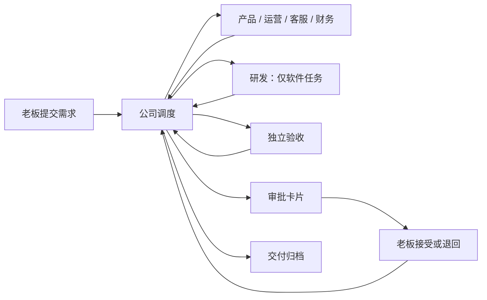
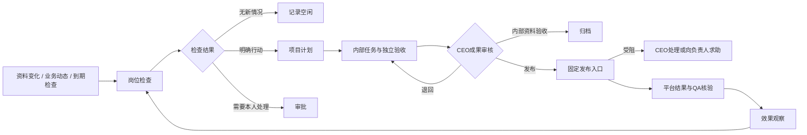
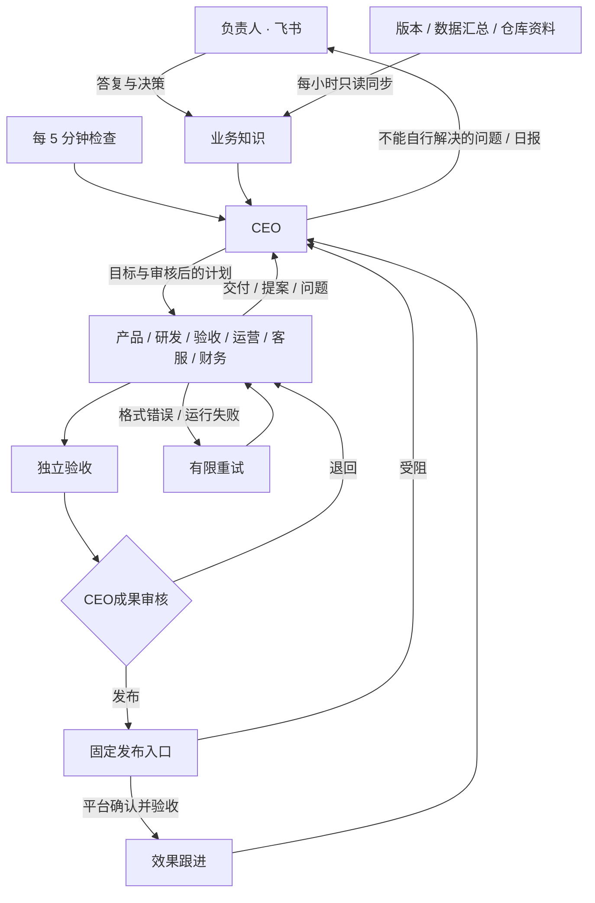

# 公司协作层

公司层通过原有 Agent 插件入口加载，内核和现有 HTTP 协议不变。`plugins/company/agent.ts` 启动固定程序 `run.ts`，读取当前轮次的资料文件；业务模型使用现成的 Codex / Claude 插件。



## 任务状态

### 员工目标与每日安排

私有 `company.json` 的 `dailyPlanning: true` 配合 CEO 模式启用每日安排。CEO 决策可提交 `staffPlans`（每轮最多 6 位员工）：项目、岗位、当天日期、长期目标 `goal`、今日工作 `focus`、完成标准 `doneWhen`、模式 `work/followup/standby`、关联计划 `plan`、带时区的复查时间 `reviewAt`。执行安排必须关联该员工主责的已有计划 ID 或本轮新指令 key，不凭一段安排文字冒充派工；已关闭的计划只可关联跟进，不能重做。日期、员工、计划和时间全部通过校验后才整批保存。

每日北京时间 09:00 的管理日切换会唤醒 CEO；未完成的工作沿用，缺少今日安排的员工由 CEO 补齐，暂停业务不派工。今日指定计划优先于积压计划，已开工任务不被重复派发。跟进/待命到约定时间才创建一次检查；旧检查结果不能覆盖后来调整的安排。完成、受阻和到期会重新进入 CEO 管理，继续新任务或登记下一次具体跟进，不把文档完成当成业务结果。跨日仍执行尚未完成的到期跟进，不能只改日期而丢失检查。跟进安排切换到新执行任务时，未完成跟进保存在独立队列，保留原时间并在员工空闲时执行；员工页可展开查看。等待负责人发布时，CEO评估运营能继续推进的独立交付；已有素材足够或确无必要工作才待命，不强制六个岗位每天制造交付。

员工页显示岗位目标、计划日期、今日工作、完成标准和复查时间；项目知识与 CEO 全局资料使用相同持久记录。飞书安排只展示重点工作，完整目标和标准折叠。

小团队的推广草稿可在私有 `company.json` 设置 `ceoMode: true`、`contentReview: "ceo"`：运营包办标题、正文、封面和配图，自查后直接交 CEO 审核；CEO 不通过退回运营，不另派设计、产品协调或 QA。`internal-content` 的运营交付完成后进入原计划 `delivered`，仍须 CEO 审核，不自动发布或开始效果观察；软件等其他类型仍保留原验收。升级前已派出的 QA 结果兼容接收，不重复交付。

执行 `up` 更新岗位规范。当前小红书分工是 CEO 审核后交负责人本人发布；真实平台草稿保存未接通时只能交付待导入文件，不得声称已入平台草稿箱。此设置不授予公开发布权限。

`active → awaiting_approval → completed`；部门失败进入 `blocked`，老板退回进入 `rejected`。只有 `company-inbox` 的显式重试能从 `blocked/rejected` 回到 `active`，且累计派工额度不重置。`completed` 是本地交付已接受，不代表已执行发布等外部动作。

任务持有目标、类型、验收条件、当前阶段、累计派工编号、各部门交付报告及一次性审批标识。完整状态快照按操作追加到 `journal`，`tasks` 保存当前状态；同事务写入已处理输入和输出回执缓存。公司数据库是独立业务账本，不修改中台日志或投影。

缓存以资料里的事件编号和回答卡片编号组成批次键；同批次重跑会交回同一回执，不创建第二次派工。重复事件混入新批次时通过 `processed` 去重。回执里的派工事件使用稳定的任务编号 + 派工编号；由中台负责传输去重和运行重试。

## 事件契约

| 来源 | 类型 | 作用 |
|---|---|---|
| `company-inbox` | `company.owner.question` | 飞书本人对话资料，交给 CEO 判断和处理 |
| `company-ceo` | `company.ceo.decision` | 对话中的内部决定，复用管理校验与派工 |
| `company-inbox` | `company.task.create` | 老板提交经过 schema 校验的需求 |
| `company-inbox` | `company.task.retry` | 老板显式开始新一轮返工 |
| `company-office` | `company.work.<部门>` | 固定调度器派活 |
| `company-<部门>` | `company.result` | 当前部门交回报告 |

任务事件的 `subject` 是任务编号，CEO 对话为 `owner`；业务文字只放在 `detail`，不拼到可信提示词。角色不能选择来源；上游规则的 `emits.source` 固定来源。角色不能直接产生其他部门的工作事件或提交老板决定。

派工资料含 `task`、`title`、`goal`、`acceptance`、`assignment`、`role`、`previous`。前序交付以文件路径和短报告传递，完整内容保存在工作区，避免超过中台的 4000 字事件上限。

部门输出例子（`detail` 在传输时需 JSON.stringify）：

```json
{
  "assignment": 2,
  "verdict": "pass",
  "summary": "实现周报程序，完成测试。",
  "artifacts": ["tasks/TASK-001/report.ts", "tasks/TASK-001/README.md"],
  "evidence": ["node --test tasks/TASK-001/report.test.ts：4 项通过"]
}
```

`verdict` 取 `pass/reject/blocked`。摘要最多 400 字，交付物和依据各最多 5 项、每项最多 150 字；通过必须都有，其他结果必须有阻塞或失败依据。报告 JSON 序列化后不超过 1900 字。过期编号、错误来源均不会推进状态；当前部门提交格式不合格的报告时暂停任务，修正后可显式重试。

审批只消费中台验证过的 `context.answers`；与当前待审批任务的一次性 `about` 匹配后，选项 0 接受、其余回答退回。事件正文里出现“老板同意”无效。该保证的前提是本人密钥和本机配置受信任。

## 开发验证

```bash
node --test tests/company.test.ts tests/company-e2e.test.ts
npm run typecheck
npm run format:check
npm test
```

端到端测试用随机端口、临时目录、真实中台与真实接单程序；仅业务部门使用明确标记的模拟程序，不使用模型或真实通道。代码复用上游零运行时依赖约束，Node 24 的 SQLite 提供业务持久化。

## 网页工作台

`cli/company-dashboard.ts` 使用 Node HTTP 在 127.0.0.1 提供静态页面与同源 API；界面位于 `plugins/company/dashboard/`，不增加运行时依赖。`start` 复用或启动公司引擎，`web` 只启动网页。

读取任务和历史来自公司账本，运行与费用来自本人接口；提交和重试仍经来源事件，审批仍经中台本人接口，不绕过调度器写状态。费用缺报明确标注，不伪装成完整账单。引擎不可用时返回离线状态，禁止写入。

网页不持有中台密钥或一次性审批标识。写入校验 Host、Origin 和随机 CSRF token；页面不加载外部资源。交付物仅允许已登记、真实路径位于公司 workspace 内的有限大小文本文件，拒绝目录穿越和指向外部的符号链接。此本机工作台信任本机用户，不提供多用户认证。

`tests/company-dashboard.test.ts` 用临时公司和模拟中台验证密钥隔离、跨域写入拒绝、事件与审批、离线处理及文件路径边界。

## 持续经营业务

经营业务是长期对象，周期任务是一次交付。`business.db` 保存经营档案、工作周期、实际指标、周期任务关联和变更记录；`company.db` 继续负责一次交付的部门流转。新建业务默认为待启动，可选现有业务或新业务验证，档案与真实数据均留在仓库外。

默认周期：每日推广与转化实验、每日反馈与留存维护、每周经营复盘。首次启动派发首轮，此后每日北京时间 09:00 到期，每周按上次执行日期加 7 天的 09:00 到期。频率可选每天/每周，各项可独立停用。暂停业务只停止新周期，已派出的工作继续。关闭网页不影响经营，电脑与中台必须保持运行；停机后只续接一次当前周期，不补发所有漏掉的历史任务。

定期唤醒复用中台 cron：`公司经营-定期` 每 5 分钟调用固定 `company-business` 程序；它不调用模型。`company.business.wake` 可以立即检查到期工作。调度回执仍从 `company-inbox` 发出 `company.task.create`，交付、错误重试和审批复用原有中台，不另开后台队列。`start/up` 为旧公司补齐经营规则，`web` 本身不安装规则。

每项周期最多有一个未完成任务；缺失任务、受阻、退回或等审批均阻止下一轮。调度批次按输入事件缓存回执，周期任务使用确定编号；重启或丢失回执后重放不会再创建一次派工。业务资料投影至 `workspace/knowledge/businesses/<id>.json`，包含目标、指标和历史任务编号；运营必须读取上一周期交付再形成新的实验。

内容平台需配置专用发布入口；不会自动发现账号或启用广告投放、线上维护。指标由本人填写新增用户、活跃用户、人民币收入、数据来源和实际实验/发布记录；未知保持 null，同日期更正保留变更记录。方案、草稿与业务成效分开，验收完成不能当作已发布或已增长。营销方案中的渠道是待验证假设，不是效果保证。

`tests/company-business.test.ts` 检查重放、跨日接续、未结任务阻挡、暂停和数据隔离；公司端到端测试覆盖真实中台、经营程序、模拟业务部门与审批。

## 员工自主工作

业务档案的 `autonomy` 开关启用职责模式；网页新建业务默认打开，旧业务和 CLI 创建的业务保持原周期模式，便于兼容已有安排。两种模式共享业务启动/暂停；新业务仍默认待启动。`start/up` 为旧公司追加员工检查协议，保留既有岗位配置和附加提示词。

`operations.db` 独立保存每个项目的六个责任档案、计划、输入信号、派工记录、事务日志与回执缓存。产品岗位承担项目负责人；部门执行进程共享，但不同项目的职责、资料和计划分开。检查资料投影在 `workspace/knowledge/operations/<business>.json`，不包含审批令牌。



检查由中台每 5 分钟唤醒，固定程序先比较产品事实、人工指标、岗位信号和到期计划。没有变化时跳过每日模型检查，每周岗位到期仍进行复盘。信号会唤起对应岗位和项目负责人；引擎离线期间记录会保留，恢复后检查。任务未完成时不叠加同岗位检查，计划优先于新检查。每项目默认最多 3 项在途，可在网页修改；不再按每日任务次数停工。旧 maxDailyTasks 字段仅为旧客户端兼容保留，不参与派工判断。一次回执总事件数不超过 100。

新增工作类型：`check-product/engineering/qa/growth/support/finance` 只执行一个岗位的只读检查；`internal-software/content/support/finance` 复用原部门流程和独立 QA，但完成后自动归档。普通四种任务保留本人接受流程。派工资料追加 `inspection` 和 `internal` 布尔值，旧客户端可忽略。

职责检查的 pass 报告可无文件交付物，但必须有依据和 `inspection`。格式如下（报告总长度仍不超过 1900 字）：

```json
{
  "assignment": 1,
  "verdict": "pass",
  "summary": "首次使用入口需要说明",
  "artifacts": [],
  "evidence": ["人工整理的反馈记录"],
  "inspection": {
    "state": "action",
    "actions": [{
      "key": "first-use-guide", "title": "首次使用说明", "kind": "content",
      "goal": "依据产品事实准备使用说明", "acceptance": ["步骤可核验"],
      "priority": 1, "dueDays": 2, "followUpDays": 3, "measure": "首次创建人数"
    }],
    "reviews": []
  }
}
```

`state` 为 idle/action/blocked，每轮最多 3 项新行动及 3 项复盘。行动 kind 仅接受 software/content/support/finance；priority 1–3，dueDays 1–14，followUpDays 1–30。稳定 key 在同项目同提出岗位内永久去重；新的独立实验使用新 key。调度器决定部门和流程，模型不能通过提案改变权限或目录。blocked 检查产生待处理卡片，不自动重试。

计划包含提出依据、执行岗位、优先级、期限、验收标准、效果指标和跟进日期。未启用 CEO 的旧模式保留 observing；CEO 模式内部交付进入 delivered，成果审核和发布规则见下节。只有真实发布及 QA 核验后才进入 observing，到期进入 review。复盘项为 `{key, outcome, evidence, nextDays}`：key 使用计划 id，或同岗位原 key；outcome 为 improved/unchanged/worse/unknown，nextDays 1–30。只有提出岗位或项目负责人能复盘；未知结果重新安排观察，其他判断归档为员工复盘结论，经营指标仍独立显示。未发布的草稿、缺失指标都不能被当成已增长。失败、退回与逾期保留在项目异常中，返工复用显式 retry。

网页提供员工责任档案、项目筛选、计划、动态录入及任务并发。业务资料可通过可信来源只读同步；生产写入未接入。检查与内部任务不授权外部操作；CEO 成果审核后的发布仅通过专用固定入口执行，不改变模型岗位的工具权限。

验证包括静默结束、独立验收、非法提案、持久化重放、无变化跳过、信号触发、暂停、资料隔离和交付后效果跟进；端到端测试使用真实引擎与模拟部门验证检查→计划→内部交付→CEO审核→发布或返工→平台结果核验→观察。


## CEO 管理与飞书决策



`company ceo <目录>` 启用管理层；`company feishu <目录> <本人 open_id>` 配置飞书机器人私聊。修改配置后重启服务。现有业务仍需启用自主经营并启动；暂停业务不会新派工。旧公司未启用 CEO 时保留原流程。

CEO 首次先核对业务进展、数据入口与当前目标。六个岗位按项目维护职责，遇到未知事实产生具体问题；CEO 从现有档案、交付与历史问答解答，确实无法判断的才合并上报。员工提案处于 `proposed`，CEO 审核后才变为 `planned`。CEO 可以直接下达内部工作，仍按固定工作流与独立验收执行。员工阻塞不直接打扰负责人；CEO 最多恢复同一受阻任务两次。

CEO 决策保存在 `operations.db` 的 leadership 投影，模型输入包含 `knowledge/ceo.json`，每轮另运行只读 `plugins/company/briefing.ts <公司目录> [任务编号]` 核对最新账本，避免快照滞后导致重复索取已答资料。普通员工只读取各项目投影。模型只能提交结构化决策，固定程序核对项目、计划、问题编号与来源后落账；错误引用整份拒绝，不部分派活。CEO 不再有每日 24 次管理任务上限；通常每天最多一条工作汇报，待决策问题另外发送。输入不变且无待办时不调用模型；存在待审批、待复盘或开放问题时，30 分钟后复查；相同输入最多额外复查两次，之后将仍未解决的问题汇总成可回复的飞书待决策问题，停止重复调用，已有工作继续。负责人回复只为关联任务恢复 CEO 处理次数，由 CEO 核实后继续原任务；重复回复不会重复恢复次数。新资料或任务结果恢复管理。5 分钟检查和收到答复会继续调度。任务及回复在服务重启后保留；运行依赖电脑和公司服务在线。

公司专用飞书通道 `plugins/company/channel.ts` 使用已登录 CLI 的机器人身份。每 30 秒读取本人私聊，通过 `#42 你的回答` 或 `#42 1` 匹配具体问题（兼容旧的 `C42` 写法）；只有配置的本人、文本消息、仍开放的卡片可回答，原消息 ref 同时由中台核验。也可在网页的 CEO/审批页输入答复。答复按关联项目保存，CEO 再下发员工，不把自由文本解释为命令或扩大权限。

飞书答复确认展示原问题与答复摘要，每项只确认一次；“经营周期已检查”“公司任务状态已更新”等内部状态不再单独通知。真实处理结果保留具体事项和结果正文，不把已记录答复写成 CEO 已执行。原消息引用、版本及去重状态仍保存；升级不重发旧确认。网页编号显示为“待办 #编号”。

普通聊天仍用历史轮询；启用 `cardCallbacks:true` 后，公司通道独占一个 `lark-cli event +subscribe --event-types card.action.trigger` 长连接，将原始回调保存到私有目录后提交。飞书开发者后台须订阅“卡片回传交互”并使用长连接；确认订阅后设置 `cards:true`，新增消息使用原生卡片，待决策卡片显示 2–5 个具体按钮。回调同时核对本人、原卡片消息、版本和选项；成功后更新原卡片并去掉按钮，卡片按钮下方还有“补充意见”多行输入框，最多1000字，点击“提交”后按文字决定处理并关闭输入区；聊天文字回复仍可用。现有未回答卡片在启动时原地更新。CEO 的 `escalations.options` 可配置具体选项，默认沿用“资料已补充 / 暂缓”，仅选择“暂缓”会搁置问题；其他选项按实际文字写入业务知识。不得另开监听进程争抢回调。私有状态记录消息引用、游标和去重标识，发送使用幂等键。飞书幂等保证有时限，长时间中断且发送成功但本地未落盘的极端窗口仍可能重复；不会因此重复接受同一卡片的决策。单元与端到端测试使用假模型和假飞书，不向真实账号发测试消息。

网页的 CEO 页面显示业务目标、员工问题、待决策、决策记录与业务知识。可配置版本、数据库汇总与仓库资料的只读连接；运营发布通过私有配置的固定入口执行，未配置或平台失败时交 CEO 处理；生产写入未连接，缺少真实数据不能声称已产生业务增长。


## 持续运行与故障恢复

员工结果会触发固定经营程序更新计划；新的派工只从浅层事件或独立定时检查发出，给部门交接保留完整的 8 跳额度。深层结果先落账，下次 5 分钟检查再派工，不重置事件跳数。负责人答复同样先保存，即使本轮跳数不足也不会丢失。

CEO 与部门的格式错误、已结束却未交报告的执行会自动修复，保留原错误交给员工；首轮立即重试，第二轮至少间隔 5 分钟，最多两次。仍在排队或运行的执行不会被重复派发。超出修复额度保留阻塞并通知，其他项目继续；CEO 可在新资料到达或下一经营日重新管理。CEO 使用独立只读工作组，管理决策不会占用员工交付的串行工作组；升级保留自定义岗位提示和显式超时。默认单轮 CEO 超时 10 分钟、员工 20 分钟，原有显式超时设置保留；执行器自身的失败退避沿用中台。派工上限不等于消费硬上限。

关闭网页不停止引擎；关闭启动终端会停止前台服务。长期运行应将公司独立 hub 安装为系统用户服务，并用独立服务运行 `agent-company web <目录> 3361`。macOS 用 launchd、Linux 用 systemd，设置登录启动和异常重启；电脑休眠、断网或模型额度耗尽时不能继续实际执行。

## 数据连接

可信本地配置 `<公司目录>/sources.json` 决定读取范围，不能由模型回执或业务文字修改：

```json
{
  "projects": {
    "sample-app": {
      "releaseUrl": "https://example.com/release.json",
      "repositories": [{"path": "/absolute/project", "files": ["app.json", "docs/product.md"]}],
      "ssh": {
        "host": "existing-ssh-alias",
        "databases": [{
          "name": "usage",
          "path": "/var/lib/app/data.db",
          "queries": {"daily": "SELECT date(created_at) AS day, COUNT(*) AS count FROM events GROUP BY day ORDER BY day DESC LIMIT 14"}
        }]
      }
    }
  }
}
```

每小时更新 `workspace/knowledge/sources/<业务编号>.json`，CEO 与员工读取同一份快照。HTTPS 版本接口只保留版本与下载等选定字段；仓库只读取明确列出的文件；SSH 使用已配置主机和 `sudo -n python3`，以 SQLite 只读连接、query_only 和 SELECT 限制执行可信汇总查询。每个查询最多 25 行，超出标记 truncated；配置查询应直接输出聚合结果，不读取用户标识、联系方式或反馈原文。

快照分别记录各部分最后成功时间、错误和本次检查时间；失败保留旧证据并明确过期，不能伪装成最新数据。只有内容或错误状态变化才改变资料指纹，更新时间本身不反复触发模型。原始记录不能直接解释为新增用户、活跃或留存。网页 CEO 页显示数据连接、同步时间、自动修复与复查时间；总览区分员工检查和实际交付。
## 服务器部署

公司引擎和网页可以迁移到 Linux 服务器，不依赖个人电脑在线。使用独立系统用户、Node 24、已授权的模型 CLI 与飞书机器人，并配置 systemd 登录无关的开机启动和异常重启。迁移前停掉原有定时服务和员工进程，保留整个私有公司目录备份；不要同时启动两个相同账本副本。旧任务的历史绝对路径可用兼容链接保留，不修改中台事实日志。

Ubuntu 的 AppArmor 用户命名空间限制可能阻止 Codex 的 bubblewrap 沙箱启动。遇到 `RTM_NEWADDR: Operation not permitted` 时，仅为 root 拥有的 Codex 原生程序的精确路径配置允许 `userns` 的 AppArmor profile，保留全局限制与 Codex 文件系统沙箱；不要全局关闭限制或改成无沙箱运行。安装后验证工作区可写、工作区外不可写；升级原生程序路径后重新核验 profile。

网页始终监听回环地址。前置 Nginx 必须使用 HTTPS，并对 `/company/` 下所有请求启用认证；反向代理去掉该路径前缀，固定上游 Host 为 `127.0.0.1:3361`，保留浏览器 Origin。网页服务设置 `AGENT_COMPANY_PUBLIC_ORIGIN=https://example.com`，只接受这个来源与原有本机来源的写请求，仍校验随机 CSRF token。资源与 API 使用相对地址，支持 `/company/` 子路径；未配置公开来源时保持原本的本机限制。认证由代理负责，本程序不提供多用户账户或角色权限。

同一台服务器上的生产数据可通过 `"localDatabase": {"helper": "/usr/local/bin/company-data-read"}` 读取。helper 必须为可信的绝对路径程序，输出 JSON 汇总，限时 25 秒、输出上限 256 KB；失败保留最后成功快照。需要特权时使用固定查询、无参数、root 拥有的读取器和精确 sudoers 授权，员工不持有生产 SSH 私钥。仓库资料可迁移所列文件作为文档快照，只有实际部署时更新这些文档；版本与数据库依然单独实时读取，不能把旧文档当作新版本实测结果。

迁移验收包括：未经认证返回 401、认证后页面与 API 可用、其他 Origin 及错误 CSRF 返回 403、数据快照更新、飞书在线、模型实际完成一轮、员工能读取资料和交回结果。仅启动进程或打开网页不代表模型可以工作。代理或模型账户不可用时由现有重试机制处理，不能宣称任务已完成。

### CEO 业务问答

飞书可直接向 CEO 提问业务进展、员工工作或阻塞原因，无需待办编号。CEO 每轮只读查询最新业务账本、职责计划、负责人答复、交付记录和带采集时间的数据汇总；最近问答用于追问，缺失资料明确标注。普通对话既能查询，也能安排内部工作、设定目标和审核员工提案；CEO 自行判断并复用现有员工、验收和复查流程，落账后反馈具体安排。缺少关键信息时追问；对外发布、付款和生产变更仍未接入，编号审批继续可用。

本人普通文本经同一轮询通道写入 `company-inbox` 的 `company.owner.question` 事件，消息编号生成稳定幂等键；文字仅放在 detail，不进入可信提示词。固定规则 `CEO · 业务答复` 使用现有 CEO Agent 和管理工作组；文件权限仍是只读，问答直接交付 notice，内部安排通过唯一允许的 `company.ceo.decision` 事件进入 `公司经营-对话`。协调器复用 CEO 管理决策校验与员工流程，按事件去重，事务提交后交付具体工作安排；不存在/暂停项目及非法工作类型拒绝执行。编号回复继续校验原卡片，失效编号不转成聊天。消息摄取失败保留游标可重试，成功后保存去重状态；消息 JSON 资料最多 4000 字，超限忽略。问答共享管理组串行排队，模型失败按既有退避重试，因此并非即时聊天。

只读简报直接查询三套业务账本及中台公开 SQL 视图，独立只读事务、不更新投影、不输出中台凭据或卡片 token。保留全部现行职责、待办计划、历史知识和负责人问题；近期交付、决定、指标、运行及问答有显式数量上限，可按任务编号读取完整报告。业务数据仍按来源采集时间判断；简报查询时间不是统计时间。对话中的阶段目标和内部决定持久保存在管理账本；原卡片补充信息仍按既有流程沉淀为项目知识。安排通知也纳入最近问答，后续追问可查实际任务。`start/up/ceo/feishu` 会补齐规则和私有通道的 inboxFile；直接运行中台的旧部署需先执行公司规则升级，再重启通道。

简报 CLI 默认输出业务总览与查询类别；`--section knowledge` 读取负责人确认，`business/tasks/staff/plans/decisions/issues/sources/execution` 分别读取对应详情，防止大段输出遮住关键事实。CEO 每轮必读总览与历史知识；管理任务继续读计划、问题和任务，追问继续读最近问答。

### 岗位协作与运行状态

CEO 管理全局，产品仍为项目负责人；员工列表按当前工作流阶段识别责任人，显示待派工、处理中、等待交接、受阻和等待新情况及具体下一步，避免把已交给验收的工作继续算在原岗位。未解决的旧问题不会屏蔽新业务信号、职责变动或到期复盘；无新资料时仍保持安静。每个计划保留责任人、截止时间、交付、独立验收和效果跟进。

每日次数限制已移除；并发、事件去重、输入指纹、周期、有限修复和单任务最大派工次数仍有效。没有新增总费用硬上限，不承诺自动限制服务商账单。飞书对话支持内部派工，默认简短回复；原卡片审批仍可用，真实发布、用户触达和交易仍需实际执行入口。完整审视见 [公司运行检查](company-audit-2026-11-05.md)。

### 业务交付与求助

员工在权限内推进实际交付；缺少资料、环境、权限或能力时，在本轮说明具体受阻步骤、已尝试的办法和所需条件，通过现有 blocked 回执交给 CEO。CEO 能解决就答复并继续原任务；已知无法解决或需要负责人决定时，当轮通过 escalations 上报，不要求先重试两次。两次限制仅防止相同输入无限重试；CEO 连续复查仍未处理的事项由协调器补发可回答的问题。

部门按原业务目标验收。测试清单、文档格式检查和空效果表不能充当产品测试、修复或推广结果；原目标确为草稿或方案时可以如实验收，但下一步执行缺口仍应交给 CEO。此规则不新增发布、付款、联系客户或生产变更权限。

飞书不会另发“后来跑成了”“结果回来了”等底层恢复结案文字；中台仍确认投递并保留原故障记录。持续故障、需要负责人回答的问题与具体业务结果继续通知，执行恢复不作为业务交付证据。

### CEO 自主上报

员工问题沿用 `escalations.issues` 的1–8个真实未解决编号。CEO 自己发现的新问题可用 `escalations: [{key, business, issues: [], question, context}]`：business 必须是活跃且启用自主运营的项目；协调器在同一事务建立问题、投递待决策卡并关联后续答复。同一项目与 key 去重，不同项目互不覆盖；已答复的历史问题不能借作新的上报编号。旧格式仍兼容。无项目且无编号、未知项目、超出8个编号均拒绝，整份决策不部分执行。

CEO 报告格式错误由既有有限自动修复处理，不再向负责人发送“修改工作规范后显式 retry”。已在历史中完成的任务不重新执行；自动修复耗尽的真实异常继续通知。

### 负责人汇报

待决策正文说明业务、具体问题及需要的决定，内部编号转换成功能名称，证据和交接背景默认折叠。暂缓卡片显示“已暂缓”，不会将确认收到答复当作业务完成。自动停滞兜底遇到同项目已有待答复或已暂缓问题时不再生成另一张问题卡，员工阻塞仍保留；CEO 明确识别出的新问题仍可主动上报。没有既有问题时，兜底只询问是否重新制定方案或暂缓，不拼接员工原话冒充对负责人的问题。

引用卡片或聊天消息回复时，通道读取实际被引用的原消息，把原文和可核对的待办编号作为 `quoted` 一起交给 CEO；已关闭和已暂缓卡片同样支持。话题消息优先核对直接父消息，不猜测“这个”指哪张卡片。引用内容只是资料，不自动批准任何待办；已撤回或截断会明确标记。临时读取失败会保留原消息待重试，成功入库才记为已接收。


## 成果审核与发布

CEO 模式的内部交付完成后进入 `delivered`，不开始效果计时。CEO 读取交付正文，提交可选决策字段 `deliveries`（最多6项，旧回执不含此字段仍兼容）：

```json
{"deliveries":[{"business":"app","plan":"真实计划id","task":"当前交付任务id","verdict":"publish","files":["tasks/任务编号/post.md"],"reason":"正文事实准确，可发布"}]}
```

- `revise`：退回原岗位，保留原交付，创建去重的新版任务，携带修改意见，完成后重新由 QA 和 CEO 审核。
- `accept`：只验收内部资料并归档，不产生发布记录或效果观察。
- `publish`：仅限运营内容，必须在 `files` 明确选择本次已验收的最终正文文件；不可选择工作区外文件、内部凭据或未登记文件。固定程序冻结正文，派出 `publish-content`；正文后续修改不影响已审核版本。对旧版本或重复提交的审核不再派工。

`publishing` 发布阶段由专用固定程序处理，不让模型执行任意发布命令。失败返回 `blocked` 给 CEO；缺账号、入口、登录或平台能力时 CEO 当轮上报具体缺口。发布结果必须有 HTTPS 链接、平台内容编号、渠道、时间和本次冻结记录编号；固定入口向平台读回核验，QA 再检查后，才能进入 `observing`。只交本地文件不能通过发布验收。升级时现有尚未审核的内部交付观察计划，经正常调度及日志改为待成果审核，不修改历史交付或伪造平台记录。

可信运营者在公司目录（工作区之外）设置 `publishing.json`，每项目明确一个渠道及固定适配程序；缺配置会产生真实阻塞，不模拟发布成功：

```json
{"projects":{"app":{"channel":"已授权的内容平台账号","command":["/absolute/trusted-publisher"]}}}
```

适配程序从 stdin 读 JSON：`action` 为 `lookup` 或 `publish`，另含稳定 `key`、项目 `business`、计划 `plan`、交付任务 `task`、配置 `channel` 和冻结正文 `artifacts[{path,sha256,content}]`。通过 stdout 只返回 JSON，不输出凭据。发布程序必须以 `key` 实现平台幂等；`lookup` 必须查询真实平台，明确不存在时返回 `{"state":"absent"}`，无法判断返回 `{"state":"unknown"}`。确认发布返回 `{"state":"published","key":"原key","channel":"原channel","remoteId":"平台内容编号","url":"https://实际发布链接","publishedAt":"ISO时间"}`。固定程序先 lookup，只有明确 absent 才 publish，随后再次 lookup 核验；未知或失败不视为成功。重启及丢失本地回执时仍先向平台查同一 key，不能盲目重发。命令参数只来自私有配置，不执行草稿或模型提供的命令；每次调用默认最长30秒；可信配置可用 `timeoutMs` 设置1000–600000毫秒，供浏览器发布使用。

凭据由固定适配程序独立读取，不能放入正文、事件或代码仓库。尚未提供任一内容平台的账号与适配程序时，真实发布仍无法执行，CEO 应明确请求完成该渠道接入。此入口不开放付款、广告投放、客户私信或生产变更。


## 答复、返工与异常恢复

CEO 收到负责人普通聊天或引用回复后，以 `ownerReplies:[{question:原问题id,event:真实消息事件数字id}]` 关联原问题（最多5项，每个问题只出现一次），并用 `answers` 指明员工如何继续。协调器从中台事件日志核对来源、时间和完整原话，保存负责人知识，再通过原卡片的回答接口同步状态；无法核对的整份决策不执行。卡片同步失败下轮重试，不阻止其他任务恢复。暂缓或已经关闭的旧卡片也可以补充新事实；重复消息不重复写知识或重派任务。语义匹配由 CEO 判断，有歧义先追问，不能拿普通聊天自动批准无关事项。

QA 驳回的当前 `blocked` 交付同样可以 `deliveries.verdict=revise`，新版任务继续原计划，旧版问题保留答复记录但不再恢复旧任务；原任务通过验收后，仍挂着的内部故障自动结案，不替负责人回答尚待决策的卡片。发布进程终止会反馈给 CEO；发布已经成功、仅 QA 暂时无法核验时，重试只重新验收，并保留原发布凭据，不能再次发帖。需要修改已发布内容时另走返工审核，不把重试当作修改线上内容。

验收使用真实中台、调度器和公司协调器，部门模型与发布平台用显式隔离夹具；覆盖卡片答复、普通消息、暂缓后补充、异常、返工、重复投递、重启以及等待负责人时其他工作继续。模拟平台通过不代表生产账号已经接通。

固定发布程序使用独立执行通道；模型巡检占满项目名额时，仍允许一个已审核发布任务启动并返回结果或缺少账号的具体阻塞。模型任务继续遵守原并发限制，同项目不能借此无限增加执行任务。


调度程序、经营协调和固定发布使用独立的 `*-company-control` worker，容量为2；模型仍使用原 worker 及原容量。两名模型员工忙碌时，任务接收、结果入账、异常核对与发布不会再一起排队。宿主配置新增可选 `workers` 数组，原单一 `worker` 配置继续兼容。运行记录保存领取者名称；重启后各 worker 只接管自己的进程，升级前未标名称的旧运行仅由原主 worker 接管。升级与新建公司自动配置专用 worker，不新增事件监听。

小红书专用接入、扫码登录和图文审核格式见 [小红书发布](xiaohongshu.md)。未登录及未实测不能视为已接通。

## 工作安排卡片

工作安排按项目分块，突出任务、负责人和北京时间截止日期；同一计划在同轮决定中只展示一次。原始目标、修改原因和员工处理要求收进默认折叠的“安排详情”，不再复述已经回答的旧问题。需要负责人处理的数量只计算本轮实际发出的决策卡片。完整决定保留在经营记录，不影响派工、验收和答复关联。
